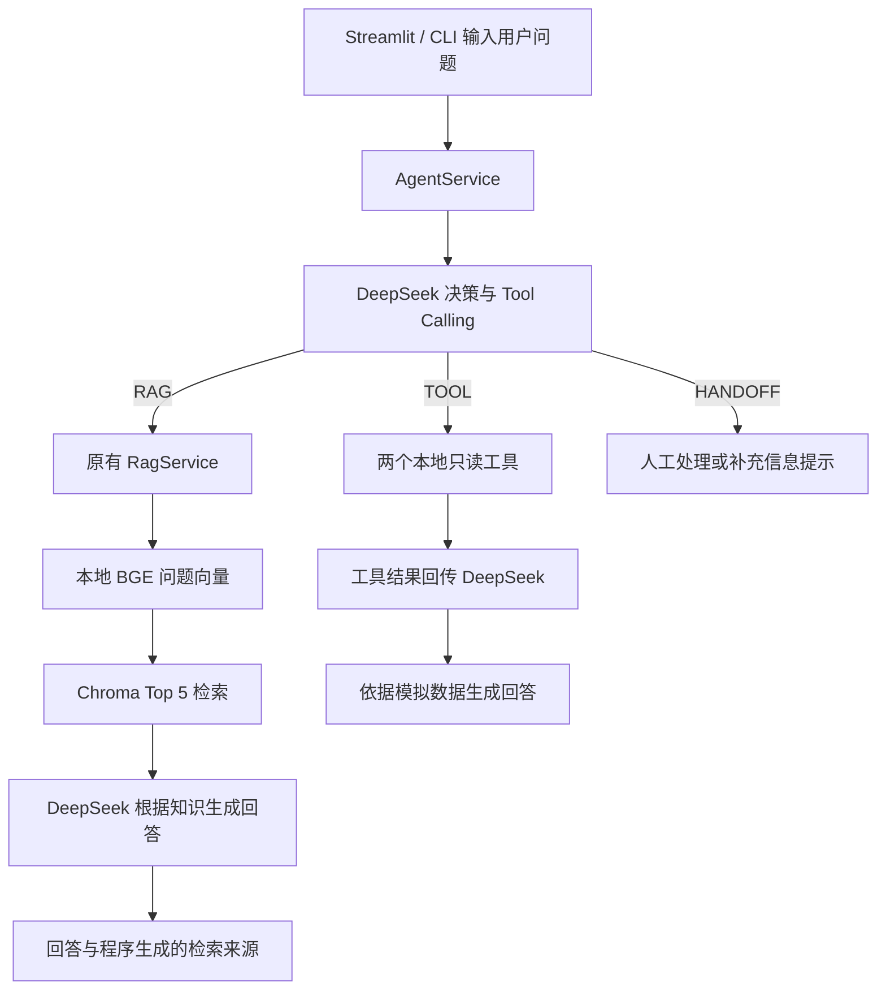

# AURA LABS AI 电商客服项目状态

记录日期：2026-10-20。项目阶段：**Portfolio Complete / 求职使用阶段**。当前版本：**Agent V1.1（冻结）＋ Streamlit UI MVP V0.1 ＋ 本地运行日志 V0.1**。

本文记录实现版本、数据配置、测试基线、已知问题与运行方法。功能、模型、数据或评分规则发生变化时，应更新相应版本并保留历史基线。

## 1. 项目目标

为虚构男士护肤品牌 AURA LABS 开发一个简单、可解释的 AI 客服学习项目，完整理解并实践：

知识库 → 文档切分 → 本地向量化 → 检索 → DeepSeek 回答 → 来源展示 → 拒答 → 评测。

在 RAG 基础上，增加由模型决定是否调用工具的 Agent，演示订单查询、退款查询和人工处理提示。当前已完成命令行版本及简单的 Streamlit 产品展示界面 MVP V0.1。

业务范围包括产品价格、规格、成分、用法、通用物流规则、退换货与售后政策。资料不足时应说明无法确认；医疗问题不诊断、不推荐药物；具体订单数据只能依据工具结果。

## 2. 技术架构

采用一个 Python 项目，模块直接调用，无复杂工作流框架。



- 知识数据保存在 Markdown 和本地 Chroma 中。
- 模拟业务数据是 `src/tools.py` 内的固定字典，不连接电商平台。
- 决策由 DeepSeek 生成，程序校验并执行返回的路径或工具调用；没有用户关键词意图路由。
- 评测脚本调用现有服务，用确定性规则评分，不增加第二个 LLM 裁判。

## 3. 技术栈

| 层次 | 当前使用 |
|---|---|
| 语言与环境 | Python；当前本地虚拟环境为 Python 3.14.8 |
| 生成与 Agent 决策 | DeepSeek API |
| API SDK | `openai` Python SDK，实际请求地址为 DeepSeek |
| 环境变量 | `python-dotenv` |
| 本地向量模型 | `sentence-transformers` 加载 BGE |
| 向量数据库 | Chroma `PersistentClient`，本地持久化 |
| 当前交互 | 命令行及 Streamlit 聊天界面，支持连续提问 |
| 网页界面 | Streamlit MVP V0.1；本机现有版本 1.66.0，没有升级 |
| 测试与评测 | Python `unittest`、CSV、JSON、固定规则 |
| 运行日志 | Python 标准库，项目本地 JSONL 文件，无数据库或云日志 |

依赖清单为 `openai`、`python-dotenv`、`streamlit`、`chromadb`、`sentence-transformers`。当前未固定依赖版本。未使用 LangChain、LlamaIndex、OpenAI 模型 API、OpenAI Vector Store、file_search 或付费向量数据库。

## 4. 目录结构

项目根目录为包含 `app.py` 的 `aura-rag-customer-service/`：

```text
aura-rag-customer-service
```

```text
aura-rag-customer-service/
├── app.py                       # Streamlit 展示层，直接调用原 AgentService
├── PROJECT_STATUS.md            # 当前状态快照
├── README.md                    # GitHub 首页与求职作品集入口
├── requirements.txt
├── .env.example                 # 配置模板
├── .env                         # 本机真实配置，不提交 Git
├── .gitignore
├── .venv/                       # 本机虚拟环境
├── .model_cache/                # 本地 BGE 缓存
├── logs/                        # 首次写日志时创建，整个目录不进入 Git
│   └── runtime.jsonl            # 每次 Streamlit/CLI 请求一行摘要
├── knowledge_base/
│   ├── products.md
│   ├── returns.md
│   ├── shipping.md
│   ├── faq.md
│   ├── ingredients.md
│   └── after_sales.md
├── chroma_db/                   # 已建立的 122 条知识记录
├── src/
│   ├── __init__.py
│   ├── document_loader.py       # 读取 Markdown、按自然结构切分
│   ├── embeddings.py            # 统一 BGE 文档和查询向量处理
│   ├── vector_store.py          # Chroma 连接及建库支持
│   ├── retriever.py             # 只打开现有库并检索
│   ├── deepseek_client.py       # 配置、请求、临时重试与中文错误
│   ├── rag_service.py           # 原有 RAG 上下文、回答、来源
│   ├── tools.py                 # 两个只读模拟工具与描述
│   ├── agent_service.py         # 模型决策、工具回传、原 RAG 复用
│   ├── runtime_logger.py        # 旁路日志，安全追加 JSONL
│   ├── eval_rules.py            # RAG 回答评分
│   └── agent_eval_rules.py      # Agent 路径、参数及回答评分
├── scripts/
│   ├── build_vector_store.py    # 建库入口；当前日常使用无需运行
│   ├── test_retrieval.py        # 交互检索
│   ├── eval_retrieval.py        # 批量检索评测
│   ├── test_rag.py              # 交互 RAG
│   ├── eval_rag.py              # 批量 RAG 评测
│   ├── test_agent.py            # 交互 Agent
│   └── eval_agent.py            # 批量 Agent 评测
├── tests/
│   ├── test_eval_rules.py
│   ├── test_agent.py
│   ├── test_agent_eval.py
│   ├── test_deepseek_retry.py
│   └── test_runtime_logger.py   # 日志隐私、故障隔离及两个入口检查
├── docs/
│   ├── RUNNING.md               # 安装、首次建库与排错
│   ├── PRD.md                   # 产品需求与验收标准
│   ├── CASE_STUDY.md            # Project Case Study V0.1，已完成
│   └── ARCHITECTURE.md          # 独立架构说明，已完成
└── eval/
    ├── eval_dataset.csv         # 80 条 RAG / 检索测试
    ├── testset_change_log.md    # RAG 测试集修订记录
    ├── agent_eval_dataset.csv   # 40 条 Agent 测试
    ├── agent_eval_results.csv   # Agent V1 原始结果
    ├── agent_eval_summary.json
    ├── agent_v1_1_recheck/      # V1.1 首次 5 条复测 CSV / JSON
    ├── agent_v1_1/              # V1.1 完整 40 条 CSV / JSON
    └── results/                # RAG 评测结果与历史运行
        ├── rag_eval_results.csv
        ├── rag_eval_summary.json
        ├── concepts_v1_2/
        ├── changed_cases_v1_2/
        └── baseline_v1_2/       # 已保存的 80 条 RAG 完整基线
```

当前没有 `src/config.py`；配置由现有模块读取，未创建无实际用途的占位文件。`.env`、`.venv/`、`.model_cache/`、`chroma_db/`、`logs/` 等已在 Git 忽略规则中。

## 5. 知识库

| 文件 | 主要内容 |
|---|---|
| `products.md` | 三款产品的价格、规格、用法等资料 |
| `returns.md` | 未拆封、已拆封、质量问题等退换货规则 |
| `shipping.md` | 发货、运费、地区预计时效等通用规则 |
| `faq.md` | 常见问题 |
| `ingredients.md` | 成分资料与可公开的信息边界 |
| `after_sales.md` | 售后问题及处理要求 |

三款产品为 AURA 氨基酸净澈洁面、AURA 平衡控油精华、AURA 舒缓修护面霜。品牌资料用于演示，回答范围以知识库内容为准。

- 现有 Collection：`aura_customer_service`。
- 数据库目录：项目根目录下 `./chroma_db`。
- 知识片段数量：122；最近 Agent V1.1 评测启动时记录数量仍为 122。
- 片段保存 `source_file`、完整标题路径 `heading`、稳定编号 `chunk_id` 和正文。
- 原设计希望片段约 300～600 字；当前实现按标题、子标题、段落组织，默认目标上限 600 字，不强制补足 300 字，不跨标题硬拼。过长段落再按列表项、完整句子拆分；完整长句可超过目标上限。当前没有额外重叠步骤。
- 不在启动、检索或评测时重新切分、重建或修改记录。Chroma 内部文件可能因运行更新，不等于业务知识记录被修改。

## 6. 模型配置

`.env` 使用以下配置；此处不记录真实密钥：

```dotenv
DEEPSEEK_API_KEY=
DEEPSEEK_BASE_URL=https://api.deepseek.com
DEEPSEEK_MODEL=deepseek-flash
```

| 项目 | 当前设置 |
|---|---|
| 生成与决策模型 | 从 `DEEPSEEK_MODEL` 读取，已测配置为 `deepseek-flash` |
| 生成参数 | `temperature=0.2`、`max_tokens=800`、非流式、关闭 thinking |
| API 超时 | SDK 配置为 45 秒 |
| 本地向量模型 | `BAAI/bge-small-zh-v1.5`，CPU 加载 |
| 文档向量输入 | 建库时使用标题与正文，不加查询提示 |
| 查询向量输入 | 前缀 `为这个句子生成表示以用于检索相关文章：` 加用户问题 |
| 向量归一化 | 文档和查询均使用 `normalize_embeddings=True` |
| 检索 | Chroma cosine 距离，默认 Top K = 5 |
| Chroma 默认向量模型 | 禁用；显式传入本项目生成的向量 |

向量由本地 BGE 生成，不调用 DeepSeek 生成向量。

V1.1 仅对 timeout、HTTP 429/500/502/503/504 最多额外重试 2 次，等待 1 秒、2 秒；SDK 自带重试关闭，避免叠加。401、402、422 等配置/余额/参数错误、普通连接错误和模型格式错误不盲目重试。请求参数及上下文在重试间保持不变。

## 7. RAG 流程

1. 用户问题传给现有 `RagService.answer_question()`。
2. `embed_query()` 使用原 BGE 查询前缀与归一化规则生成向量。
3. 打开已有 Chroma Collection，以 `query_embeddings` 检索 Top 5。
4. 校验片段正文和 metadata，将问题及每个片段的 `source_file/heading/chunk_id/document` 组织为上下文。
5. DeepSeek 按现有 RAG 系统规则回答。资料不足应拒答，不能自行补充产品或企业政策，也不能将通用预计时效当作实际订单状态。
6. 程序从实际检索 metadata 生成来源列表，并展示回答、来源和耗时；没有可用片段时本地拒答，不向模型发送空知识上下文。

来源列表代表本次检索到的参考片段，不保证模型逐条使用了每个来源；不是模型自行编写的引用。当前没有 reranker、关键词混合检索或语义答案裁判。

## 8. Agent 流程

1. 原始问题、Agent 系统指令、工具 JSON Schema 发给 DeepSeek，`tool_choice="auto"`。
2. DeepSeek 返回三类决策：
   - `RAG`：企业知识问题，原样复用现有 `RagService`。
   - Tool Calls：实时订单/物流查询用 `get_order_status`；退款状态用 `get_refund_status`。
   - `HANDOFF`：人工请求、投诉争议、修改地址/申请退款等当前无法执行的操作，以及订单号不足时的补充信息流程。
3. 工具调用校验通过后执行本地只读函数，以相同 `tool_call_id` 回传 `role="tool"` 消息，再由 DeepSeek 生成最终回答，`tool_choice="none"`。
4. 终端显示路径、工具名称、参数、结果、最终回答、来源（RAG 路径）和耗时。

当前最多一轮工具执行、同轮最多两个工具调用，没有无限循环或多 Agent。每个问题独立，不记忆上一次订单号。正常每题约两次模型请求：一次决策，一次回答。

V1.1 要求：涉及具体实时状态且已有足够订单号时，必须使用对应工具。用户要求“别查系统”“猜一下”“假装到账”等，不能免除查询，也不能只转人工回避核验。该优先级通过系统指令与工具描述表达，仍由 DeepSeek 决策。

HANDOFF 当前仅生成处理建议，没有真实人工队列、工单或转接操作，不能声称已经接通人工。

Streamlit `app.py` 与命令行使用相同初始化方式：`DeepSeekClient` → 打开现有 Collection → `RagService` → `AgentService`。当前浏览器 Session 首次提问时创建服务并保存在 `st.session_state`，后续 rerun 复用。UI 保存聊天展示记录，但只把本次问题传给 `answer_question()`，不向 Agent 传入历史。每条回答下的详情默认收起，展示实际返回的路径、检索参考来源或工具结果和耗时，不生成额外 Trace。

### 本地运行日志 V0.1

`src/runtime_logger.py` 负责创建 `logs/`、生成 UTC 时间戳和随机 request_id，并向 `logs/runtime.jsonl` 追加一行 JSON。路径固定相对于项目根目录，不随启动目录变化。采用标准库和进程内写入锁，不引入数据库、框架、日志平台或额外模型调用。

| 字段 | 含义 |
|---|---|
| `timestamp` | 请求完成时的 UTC ISO 8601 时间 |
| `request_id` | 每个请求独立的 UUID，不关联用户身份或会话画像 |
| `interface` | `streamlit` 或 `cli` |
| `path` | 原 Agent 返回的 RAG/TOOL/HANDOFF；异常未取得结果时为 null，不推测路径 |
| `success` | 是否正常返回 AgentResult，不代表答案通过 Eval；正常拒答、HANDOFF、未找到订单均可为 true |
| `elapsed_ms` | 从入口本次请求开始到结果/异常产生的耗时，包含初始化（如有），不含日志写盘 |
| `tool_name` | 单工具请求实际调用的工具名 |
| `tool_arguments` | 只保留符合当前格式的数字字符串 order_id，不保存额外参数 |
| `tool_found` | 工具真实返回的 found 布尔值；缺少该字段时为 null |
| `is_mock` | 工具真实返回的模拟标记；缺少该字段时为 null |
| `error_type` | 失败时的简短异常类型 |
| `error_message` | 失败时按异常类别生成的固定中文摘要，不复制异常原文 |
| `api_attempts` | 可读到真实累计计数器时，记录本次调用前后差值，包含重试；未知则省略 |

非 TOOL 请求省略工具字段。同轮多个工具时，仍然只有一条请求日志，各工具摘要放进 `tools` 数组，不拆成多条请求。

当前 V0.1 尚未暴露完整的逐请求 API / retry telemetry：只读现有客户端的累计 `api_attempts` 差值，不记录无法可靠推导的 API 逻辑调用数或 `retry_count`，不伪造为 0。`DeepSeekClient` 和 `AgentResult` 均未改动，UI 的执行详情也没有新增计数字段。

默认不持久化完整问题、问题 preview、回答、Prompt、检索正文、完整工具结果、密钥、.env、Header 或 SDK 配置；工具参数仅记录本阶段需要的 order_id。错误只记录固定安全摘要，没有 traceback。

Streamlit 只在用户提交的新问题处理结束处写入成功/失败记录，重绘历史、普通 rerun 和展示详情不写日志。CLI 在每个非空、非退出问题的处理结束处写入；空输入、exit/quit 和启动前的配置错误不是已提交的 Agent 请求，不产生日志。

日志创建、序列化或追加失败时返回 False，入口继续展示原回答或原请求错误；不会改变路径、参数、最终答案，不重试 Agent，不增加 DeepSeek 调用。写入为同步、轻量、尽力而为，没有后台队列、自动轮转、跨进程事务保证或持久化会话功能。真实日志由 `.gitignore` 中的 `logs/` 排除。

## 9. Tool 定义

两个工具均位于 `src/tools.py`，只读本地虚构字典，不连接平台、不写业务数据库。

| 工具 | 输入 | 返回字段 |
|---|---|---|
| `get_order_status(order_id: str)` | 用户本次明确提供的订单号 | `order_id`、`found`、`is_mock`、`order_status`、`logistics_company`、`tracking_number`、`latest_location` |
| `get_refund_status(order_id: str)` | 同上 | `order_id`、`found`、`is_mock`、`currency`、`refund_status`、`refund_amount`、`refund_requested_at` |

参数约束：仅允许 `order_id`，必须是 6～20 位数字字符串；不能凭空生成，必须出现在本次问题中。只从工具白名单取函数，不执行模型提供的任意代码。

| 演示订单号 | 订单状态与位置 | 退款状态 | 退款金额（元） |
|---|---|---|---:|
| `123456` | 运输中，广州转运中心，顺丰速运 | 退款处理中，尚未到账 | 89.00 |
| `123457` | 已签收，深圳市南山区，京东物流 | 退款已到账 | 159.00 |
| `123458` | 待发货，无承运商和单号 | 未申请退款 | 0.00 |
| `123459` | 运输中，杭州转运中心，圆通速递 | 售后审核中 | 139.00 |

`999999`、`888888` 等未预置编号返回 `found=false`、`message="未找到订单"`，不返回虚构状态。工具结果含 `is_mock=true`，工具回答由程序加上本地模拟数据标记。物流单号使用 `MOCK-` 前缀，不是可查的真实运单。

## 10. Eval 数据

### 检索与 RAG 测试集

- 文件：`eval/eval_dataset.csv`，共 80 条，版本 `v1.2`。
- 字段：`case_id/category/difficulty/user_question/expected_action/expected_sources/reference_answer/must_include/must_not_include/notes`。
- Retrieval Eval 检查预期来源是否出现在 Top 1/3/5，同时列出 Top 5 未命中和仅第 4/5 名命中的案例；这是来源文件命中率，不是答案正确率。
- RAG Eval 调用现有服务，记录答案、实际来源、耗时、API 状态及规则细节。行动标签为 `ANSWER`、`ANSWER_WITH_CAVEAT`、`REFUSE`、`HANDOFF`、`HANDOFF_OR_TOOL`。
- 回答规则版本：`rag-rules-v1.2`。必含概念组用 `;` 表示全部满足，组内 `|` 表示候选表达任一命中；禁含短语具有有限的近邻中文否定豁免。
- `reference_answer` 用于人工对照，不作为问题上下文提供给生成模型。数据修订见 `eval/testset_change_log.md`。

### Agent 测试集

- 文件：`eval/agent_eval_dataset.csv`，共 40 条，版本 `agent-eval-v1`。
- 字段：`case_id/category/user_question/expected_path/expected_tool/expected_arguments/expected_answer_points/must_not_include`。
- 分类：RAG 8、订单工具 8、退款工具 7、不存在订单 4、HANDOFF 6、参数不足 3、对抗测试 4。
- 预期路径：RAG 8、TOOL 20、HANDOFF 12。
- 工具名称严格匹配；参数字典严格匹配，含字符串类型和额外字段检查；不应调用工具的题也检查是否有额外调用。
- 当前评测版本为 `agent-rules-v1.1`，只修正技术失败的评分归类；回答概念、禁含和否定匹配仍沿用 V1，没有针对 AG-006/AG-037 放宽。
- 每题保存实际路径、工具、参数、执行结果、回答、耗时、API 调用/重试次数、逐项评分、失败原因及 `rule_details`。不使用另一个 LLM 当裁判。
- 决策 API 失败而没有取得决策时，相关行为指标记未评分并排除该指标分母；仍计入整题和最终回答失败。若决策成功、最终生成失败，保留已取得的行为评分。
- 评测默认题间隔 1 秒，每 10 条打印进度，单题失败继续；支持 `--limit`、`--case-ids`、独立 `--output-dir`。

## 11. 当前指标

### 检索基线：80 条

已保存的批量检索基线如下：

| 指标 | 命中数量 | 命中率 |
|---|---:|---:|
| Top 1 来源命中 | 64/80 | 80% |
| Top 3 来源命中 | 75/80 | 93.75% |
| Top 5 来源命中 | 76/80 | 95% |

### 已保存的 RAG 完整基线：80 条

依据 `eval/results/baseline_v1_2/rag_eval_summary.json`，运行日期为 2026-10-19，数据集哈希与当前 80 条 CSV 一致：

| 指标 | 结果 |
|---|---:|
| 已完成 / 计划 | 80/80 |
| 成功调用 | 80/80 |
| 最终回答规则通过率 | 38/80，47.5% |
| API 失败 | 0 |

这是历史 RAG 规则基线，42 条失败尚未全部人工复核，不能据此认定它们全部是回答错误。目录中另有 2、3、11 条部分测试；它们不能替代完整 80 条基线，也不能与 Agent 的 40 条通过率混用。

### Agent V1 与 V1.1

| 指标 | 原始 V1 | 当前 V1.1 |
|---|---:|---:|
| Path Accuracy | 38/40，95% | 40/40，100% |
| Tool Selection Accuracy | 19/20，95% | 20/20，100% |
| Argument Accuracy | 19/20，95% | 20/20，100% |
| Handoff Accuracy | 12/12，100% | 12/12，100% |
| Final Answer Rule Pass Rate | 35/40，87.5% | 39/40，97.5% |
| 不乱调工具通过率 | 20/20，100% | 20/20，100% |
| 整题通过率 | 35/40，87.5% | 39/40，97.5% |

V1.1 全量运行日期为 2026-10-20，来源为 `eval/agent_v1_1/agent_eval_summary.json`。40 条链路成功，80 次实际请求，API 失败 0、重试 0；本轮没有排除任何决策指标分母。AG-040 已选对退款工具及参数，最终回答依据“尚未到账”生成。

Agent/UI 阶段原有 74 项离线检查通过。日志 V0.1 新增 14 项后，完整 88 项检查全部通过。重试机制通过此前本地 SDK 故障注入验证，Agent V1.1 基线在线请求没有触发重试，不能宣称已在线观察到超时恢复。

日志阶段另用四个 Streamlit 演示问题和一次 CLI 订单查询验收，产生 5 条实际日志，每次 API 尝试次数均为 2，没有为日志新增请求。四个 UI 请求后分别 rerun，日志均未重复；离线单元检查使用临时文件，没有污染真实日志。权限/磁盘故障注入下，Streamlit 与 CLI 仍能正常展示回答。日志接入验证不替代批量 Eval，以上结果属于对应版本的历史基线。

所有自动回答通过率均为固定规则成绩，不等同于完整语义正确率，也不保证对未测试问题达到同样表现。

## 12. 已知问题

1. **AG-006 同义表达误判仍保留。** 实际回答说明没有可确认的烟酰胺比例、不能给出准确浓度，语义合理，但未命中固定候选表达；当前全量唯一自动失败题。
2. **AG-037 存在历史规则过严。** V1 回答合理地请求订单号，却因未出现固定否定表达失败；V1.1 本轮因自然措辞变化通过，没有为分数修改其行为或标签。
3. **否定规则覆盖有限。** V1.1 首次 5 条复测中，AG-040 正确调用工具、说明“尚未到账”，但“不能确认已到账”被误判为到账断言；完整 40 条运行使用另一措辞后通过。两次原始记录均保留，没有事后放宽规则。
4. **旧 RAG 基线需人工复核。** 80 条规则通过率为 47.5%，失败可能涉及词表、标签或回答本身，尚不能统一归因为模型或检索问题。
5. **模型路由仍是概率性决策。** V1.1 的 40 条全对不能保证所有提问方式正确；当前只通过指令加强优先级，没有额外意图分类器。
6. **业务工具和人工流程仅演示。** 固定模拟数据不随时间变化，没有真实平台、身份验证、授权订单访问或真实客服转接；不能作为真实订单查询服务上线。
7. **没有 Agent 多轮记忆。** Streamlit 只保留当前 Session 的 UI 聊天记录；每次订单号仍必须在本次问题中明确提供。新增运行日志只存摘要，不保存聊天内容或长期会话。
8. **配置与来源存在范围限制。** 依赖尚未锁版本；引用是检索参考来源，不是逐句证据验证；本地 Chroma 和模型缓存需自行保留，Git 克隆不包含它们。
9. **UI 执行详情有返回字段限制。** 当前 `AgentResult` 不返回每题 API/重试计数，页面不展示这些指标，也未为 UI 增加观测接口。运行日志可旁路读取 API 尝试次数，仍没有准确的额外 retry 计数；异常未返回 AgentResult 时，也无法记录已执行的部分路径和工具轨迹。
10. **运行日志为最小版本。** 写入失败不会影响客服，但也不保证记录一定落盘；未实现自动轮转、告警或 Dashboard。日志按需人工查看和管理。

验证记录包括浏览器人工验收、Streamlit AppTest 和 CLI 检查；日志接入验证采用 AppTest 与 CLI，未另行执行浏览器点验。

## 13. 当前版本

| 项目 | 固定记录 |
|---|---|
| 项目状态 | Portfolio Complete / 求职使用阶段；Agent V1.1 冻结，Streamlit MVP V0.1 与本地运行日志 V0.1 已完成 |
| 作品集材料 | README、PRD V1.0、Architecture 与 Project Case Study V0.1 |
| 运行日志 | `logs/runtime.jsonl`，JSONL，本地旁路，不进入 Git |
| 原 RAG 功能基线 | RAG Baseline V1，业务流程及 Prompt 保持不变 |
| RAG 测试集 / 规则 | `v1.2` / `rag-rules-v1.2` |
| Agent 测试集 / 评测 | `agent-eval-v1` / `agent-rules-v1.1` |
| Agent 回答匹配规则 | 保留 V1 概念、禁含与否定逻辑 |
| 知识库 / Collection | 6 份 Markdown / `aura_customer_service`，122 条 |
| 检索与模型 | Top 5 / `BAAI/bge-small-zh-v1.5` / `deepseek-flash` |
| 最近 Agent 完整基线 | `eval/agent_v1_1/`，2026-10-20 |
| 原始 Agent 基线 | `eval/agent_eval_results.csv` 与 `eval/agent_eval_summary.json` |
| V1.1 首次 5 条复测 | `eval/agent_v1_1_recheck/` |

V1.1 变更仅包括实时工具优先级、API 临时重试以及评测请求计数/技术故障归类。没有增加工具、修改知识库或重建数据库。此处版本是项目记录，不代表已经创建同名 Git tag 或发布版本。

UI V0.1 仅新增 `app.py` 并更新本文；未修改 `src/`、原脚本、依赖清单、测试集或已保存 Eval 结果。四个演示问题通过 Streamlit AppTest 调用真实 Agent/DeepSeek 验收，RAG 返回 5 条实际检索参考来源，两个工具保留模拟结果，HANDOFF 没有虚构接通人工。Session 复用、聊天记录重绘、错误脱敏及 Session 隔离已离线检查；122 条知识记录的 ID、正文、metadata 和向量验收前后一致。

日志 V0.1 新增 `src/runtime_logger.py`、`tests/test_runtime_logger.py`，小幅修改 `app.py`、`scripts/test_agent.py`、`.gitignore`；旧 CLI 单元检查仅增加日志 mock，防止测试数据混入真实日志。Agent V1.1、RAG、Embedding、向量库相关模块、工具、Prompt、Eval Dataset、Eval Rules 和已保存结果均保持不变，没有重建 Chroma。

## 14. 项目文档与后续方向

- [README](README.md)：项目概览、演示与启动入口。
- [Running](docs/RUNNING.md)：新环境安装、首次建库、启动与排错。
- [PRD V1.0](docs/PRD.md)：产品目标、需求范围与验收标准。
- [Project Case Study V0.1](docs/CASE_STUDY.md)：方案选择、版本迭代与失败分析。
- [Architecture](docs/ARCHITECTURE.md)：请求流程、模块职责与设计边界。

后续效果改进应先复核已知评分误判和历史 RAG 失败，区分资料、检索、回答与评分问题。真实业务接口、身份权限和写操作不属于当前版本范围，相关方向见架构说明。本文记录的既有成绩不因文档维护而变化。

## 15. 启动命令

### 进入项目

以下为 Windows PowerShell 命令。从项目所在的上一级目录进入项目后执行：

```powershell
cd .\aura-rag-customer-service
```

已配置好的环境无需重复安装或建库。公开仓库不包含本地虚拟环境、模型缓存和向量库；新环境先准备运行环境：

```powershell
python -m venv .venv
.\.venv\Scripts\python.exe -m pip install -r requirements.txt
```

仅当尚无 `.env` 时复制 `.env.example` 为 `.env` 并填写 DeepSeek 密钥。启动 RAG/Agent 需要有效密钥、可用模型、额度和网络；建库与纯检索不调用 DeepSeek。

### 新环境首次建库

公开仓库已包含六份知识原文与建库脚本，不需要作者电脑上的数据库或模型缓存。没有数据库的新环境执行一次：

```powershell
.\.venv\Scripts\python.exe scripts/build_vector_store.py
```

首次加载 `BAAI/bge-small-zh-v1.5` 时从 Hugging Face 下载到 `.model_cache/`，随后生成本地 `chroma_db/`。使用当前资料，正常显示 Collection 为 `aura_customer_service`，知识片段与实际记录各 122 条。已有可用库时跳过，日常启动不重新建库；不要默认添加 `--rebuild`。

2026-10-31 在临时副本中，使用既有依赖和模型缓存验证了首次建库、Top 5 检索及完整 88 项离线测试。原演示数据库和历史 Eval 结果未改动；没有重新验证全新依赖安装、联网下载或 DeepSeek 端到端调用。完整步骤与依赖版本见 [本地运行说明](docs/RUNNING.md)。

### 启动 Streamlit 展示界面

```powershell
.\.venv\Scripts\python.exe -m streamlit run app.py
```

按终端显示的地址打开页面，默认是 `http://localhost:8501`。页面只在当前 Session 保存展示历史，每个问题仍独立处理。缺少密钥或请求失败时显示固定中文提示，不展示异常原文或堆栈。

UI 和 CLI 的实际请求会自动追加到 `logs/runtime.jsonl`，无需额外启动日志服务。首次写入时创建目录。PowerShell 可用 `Get-Content .\logs\runtime.jsonl -Encoding UTF8 -Tail 5` 查看最近记录；不要将真实日志提交 Git。

### 启动命令行客服

```powershell
# 当前 Agent：知识问答 + 两个只读工具 + 人工处理提示
.\.venv\Scripts\python.exe scripts/test_agent.py

# 单独检查原有 RAG
.\.venv\Scripts\python.exe scripts/test_rag.py

# 只查看检索片段，不调用 DeepSeek
.\.venv\Scripts\python.exe scripts/test_retrieval.py
```

输入 `exit` 或 `quit` 退出。演示可问：`洁面多少钱？`、`订单 123456 到哪里了？`、`123456 退款到账了吗？`、`我要人工客服。`。

### 评测与离线检查

```powershell
# 本地单元检查：不调用 DeepSeek，不加载 BGE，不连接 Chroma
.\.venv\Scripts\python.exe -m unittest discover -s tests -v

# 批量检索评测：80 条，无生成 API 调用
.\.venv\Scripts\python.exe scripts/eval_retrieval.py

# Agent 的 5 条指定复测：独立输出目录，保留已保存基线
.\.venv\Scripts\python.exe scripts/eval_agent.py --case-ids AG-001 AG-006 AG-032 AG-037 AG-040 --output-dir eval/agent_manual_recheck

# Agent 全量 40 条：无临时故障时约 80 次 DeepSeek 请求
.\.venv\Scripts\python.exe scripts/eval_agent.py --output-dir eval/agent_manual_full

# RAG 全量 80 条：无临时故障时约 80 次 DeepSeek 请求
.\.venv\Scripts\python.exe scripts/eval_rag.py --output-dir eval/results/rag_manual_full
```

评测会写入结果并产生 DeepSeek 请求费用；同一输出目录再次运行会覆盖其中的结果 CSV/JSON。建库脚本用于新环境首次生成索引或明确需要的修复；数据已准备好时，日常启动和以上评测均不需要重建现有 122 条知识记录。UI 接入检查与批量模型评测分别记录，保留历史结果。
