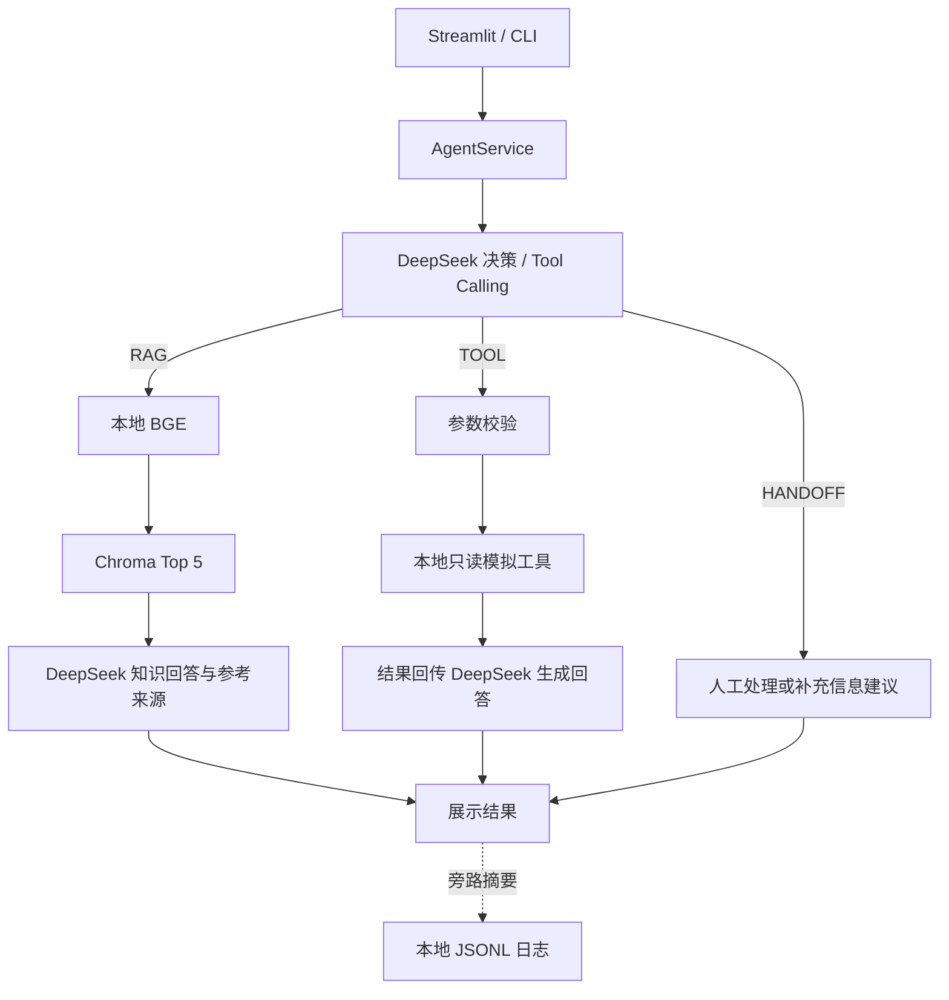

# AURA LABS AI Customer Service Agent

面向虚构护肤品牌的 AI 客服作品集：企业知识用 RAG，订单与退款状态用只读工具，超出能力的诉求给出人工处理建议。

**Agent V1.1（冻结）· Streamlit MVP V0.1 · Runtime Logging V0.1**

## 阅读导航

| 想了解什么 | 文档 |
|---|---|
| 项目能力、结果和演示方式 | 本页 |
| 需求拆分、版本迭代与失败分析 | [Case Study](docs/CASE_STUDY.md) |
| 请求流程与模块职责 | [Architecture](docs/ARCHITECTURE.md) |
| 产品范围与验收条件 | [PRD](docs/PRD.md) |
| 安装、首次建库与排错 | [Running](docs/RUNNING.md) |
| 完整配置、历史基线与已知问题 | [项目状态](PROJECT_STATUS.md) |

## 核心能力

| 能力 | 实现 |
|---|---|
| 企业知识问答 | 6 份 Markdown、122 个片段；BGE + Chroma Top 5 检索，DeepSeek 回答并展示参考来源 |
| 订单 / 退款查询 | 模型选择 `get_order_status` / `get_refund_status`，程序校验参数后读取本地模拟数据 |
| HANDOFF | 人工处理或补充信息提示，不执行真实转接 |
| 展示与观测 | Streamlit / CLI 共用 AgentService，折叠详情展示实际结果；JSONL 日志失败不影响回答 |
| 验证 | 分开评测检索、RAG 回答与 Agent 行为，保留原始结果与失败案例 |

技术栈：Python、`BAAI/bge-small-zh-v1.5`、Chroma、DeepSeek（配置为 `deepseek-flash`）、Streamlit。`openai` 仅作兼容 SDK，实际请求 DeepSeek；未使用 LangChain / LlamaIndex。

## 架构



DeepSeek 选择路径，程序执行工具白名单与参数校验，UI 不按关键词重新路由。每个问题独立，页面聊天历史不传给 Agent。

## 评测结果

以下为已保存的固定集结果，不代表真实流量表现。

| 测试 | 指标 | 结果 |
|---|---|---:|
| Retrieval，80 条 | Top 1 / 3 / 5 来源命中 | 64/80（80%）· 75/80（93.75%）· 76/80（95%） |
| RAG，80 条 | 最终回答规则通过率 | 38/80，47.5% |
| Agent V1.1，40 条 | Path Accuracy | 40/40，100% |
| Agent V1.1，工具题 20 条 | Tool Selection / Argument Accuracy | 各 20/20，100% |
| Agent V1.1，人工及补充信息题 12 条 | Handoff Accuracy | 12/12，100% |
| Agent V1.1，40 条 | Final Answer Rule Pass Rate | 39/40，97.5% |

**来源命中率不是回答准确率；规则通过率也不是完整语义准确率。** RAG 的 42 条失败尚未全部人工复核。Agent 当前唯一自动失败 AG-006 为同义拒答未命中规则，原始成绩保留。离线检查 88 项通过。

V1.1 仅加强实时工具优先级、加入有限 API 重试，并修正技术故障归类与请求计数；未更换知识库、模型、Top K、工具或测试集。迭代与误判分析见 [Case Study](docs/CASE_STUDY.md)。

结果入口：[RAG 完整基线](eval/results/baseline_v1_2/rag_eval_summary.json)、[Agent V1.1 完整基线](eval/agent_v1_1/agent_eval_summary.json)。

## 四步演示

启动后展开“查看 Agent 执行详情”：

| 问题 | 观察内容 |
|---|---|
| 洁面多少钱？ | RAG 回答与实际检索参考来源 |
| 订单 123456 到哪里了？ | 订单工具、参数和本地模拟结果 |
| 123456 退款到账了吗？ | 退款工具；预置结果为处理中、尚未到账 |
| 我要人工客服。 | HANDOFF 建议，不声称已接通人工 |

## 快速运行

Windows PowerShell，在包含 `app.py` 的项目根目录执行。已有可用环境时跳过安装；没有数据库的新环境需先建库。

```powershell
python -m venv .venv
.\.venv\Scripts\python.exe -m pip install -r requirements.txt
if (-not (Test-Path .env)) { Copy-Item .env.example .env }
```

在 `.env` 中配置自己的 `DEEPSEEK_API_KEY`，基础地址为 `https://api.deepseek.com`，模型由 `DEEPSEEK_MODEL` 指定，原基线使用 `deepseek-flash`。

```powershell
# 仅新环境首次建库：加载/下载 BGE，生成本地索引，不调用 DeepSeek
.\.venv\Scripts\python.exe scripts/build_vector_store.py
# 启动网页，通常访问 http://localhost:8501
.\.venv\Scripts\python.exe -m streamlit run app.py
# 或使用 CLI，exit / quit 退出
.\.venv\Scripts\python.exe scripts/test_agent.py
```

六份知识原文和建库代码均已提供，不需要作者电脑上的模型缓存或数据库。首次 BGE 下载需要访问 Hugging Face；已有库不重建，不默认使用 `--rebuild`。完整问答需要有效密钥、可用模型与额度，会产生 API 费用。完整步骤、验证环境与离线检查命令见 [Running](docs/RUNNING.md)。

## 目录与边界

`src/` 为业务与评测模块，`scripts/` 为 CLI / 建库 / Eval 入口，`knowledge_base/` 为知识原文，`eval/` 为测试集及历史结果，`tests/` 为离线检查，`docs/` 为说明文档。`.env`、虚拟环境、模型缓存、Chroma 数据和运行日志不进入 Git。

这是虚构品牌的求职 Demo，未连接真实电商、ERP、物流、支付或客服系统。工具只读，没有身份认证、订单授权、真实人工转接或多轮 Memory；检索来源不是逐句证据验证。模型路由有概率性，依赖未完整锁定，日志没有生产级可靠性保证。
