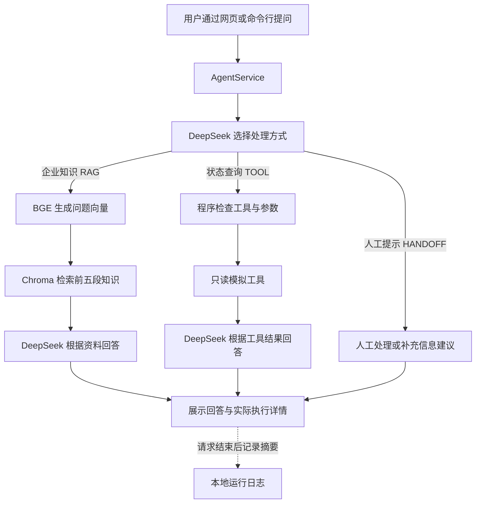

# AURA LABS AI Customer Service Agent

面向虚构护肤品牌的 AI 客服作品集。系统根据问题选择处理方式：企业知识查资料，订单与退款状态查工具，超出能力的请求提示人工处理。

**Agent V1.1 · Streamlit 展示页面 V0.1 · 本地运行日志 V0.1**

## 项目解决什么问题

客服问题需要不同的回答依据。“广州一般几天到”查物流规则，“订单 123456 到哪里了”查具体订单，“退款审核有争议”则需要人工处理。项目将三类请求分别处理，并通过测试检查检索、工具调用和最终回答。

这是本地演示项目：品牌资料和订单均用于模拟，不连接真实电商、物流、支付或客服系统。

## 建议阅读顺序

首次了解项目可先读本页，再查看案例。需要检查实现或本地运行时，使用后面的文档。

| 文档 | 重点内容 |
|---|---|
| [项目案例](docs/CASE_STUDY.md) | 问题拆分、方案选择、版本迭代与失败分析 |
| [架构说明](docs/ARCHITECTURE.md) | 请求怎样流转，模型、代码与工具怎样分工 |
| [产品需求](docs/PRD.md) | 用户场景、功能范围、业务规则与验收条件 |
| [运行指南](docs/RUNNING.md) | 安装、首次建库、启动与常见问题 |
| [项目状态](PROJECT_STATUS.md) | 完整配置、测试版本、历史成绩与已知问题 |

## 核心能力

| 能力 | 用户能看到什么 | 实现方式 |
|---|---|---|
| 企业知识问答 | 产品、物流和售后回答，以及检索参考来源 | BGE 将问题转成向量，Chroma 检索前五段知识，DeepSeek 根据资料回答 |
| 订单与退款查询 | 指定订单的模拟状态 | DeepSeek 选择查询工具，程序检查订单号后执行，再根据结果回答 |
| 人工处理提示 | 人工处理或补充信息建议 | 超出能力、存在争议或信息不足时，给出下一步提示 |
| 网页与命令行 | 问答、耗时和可展开的执行详情 | 两个入口共用同一个 AgentService，每个问题独立处理 |
| 运行记录与评测 | 请求摘要、逐题成绩与失败原因 | 本地 JSONL 日志加分层测试；日志写入失败不影响回答 |

知识库有 **6 份 Markdown、122 个片段**。两个工具分别为 `get_order_status`（订单状态）与 `get_refund_status`（退款状态），都只能查询本地模拟数据，不能修改订单或执行退款。

技术栈：Python、`BAAI/bge-small-zh-v1.5`、Chroma、DeepSeek、Streamlit。生成模型从环境变量读取，测试基线使用 `deepseek-flash`；`openai` 仅为兼容 SDK，实际请求 DeepSeek。项目未使用 LangChain 或 LlamaIndex。

## 系统怎样处理一个问题



模型负责选择，程序负责检查并执行。网页不再根据关键词另选工具。页面保留的聊天历史只用于显示，不传给模型，因此没有多轮记忆。

## 已保存的评测结果

测试分三层：先看资料是否找对，再看回答是否符合要求，最后检查 Agent 的路径、工具和参数。评分由代码规则完成，没有额外调用另一个大模型作为裁判。

| 测试 | 检查对象 | 结果 |
|---|---|---:|
| 检索，80 条 | 预期来源出现在前 1 / 3 / 5 个结果中 | 64/80（80%）· 75/80（93.75%）· 76/80（95%） |
| RAG 回答，80 条 | 必要信息、禁止内容与处理方式 | 38/80，47.5% |
| Agent V1.1 | 路径选择（Path Accuracy） | 40/40，100% |
| Agent V1.1 | 工具选择与参数（Tool Selection / Argument Accuracy） | 各 20/20，100% |
| Agent V1.1 | 人工及补充信息路径（Handoff Accuracy） | 12/12，100% |
| Agent V1.1 | 最终回答规则通过率 | 39/40，97.5% |

这些指标衡量不同环节，不能合成一个“AI 准确率”。来源命中不保证答案正确，规则通过也不等于完整语义正确，更不能外推到真实流量。

RAG 的 42 条失败尚未全部人工复核。Agent V1.1 的唯一自动失败为 AG-006：合理的同义拒答没有命中评分规则，原始成绩仍保留。已有 **88 项离线检查通过**。

V1.1 的修改集中在实时查询的工具优先级、临时 API 错误重试，以及技术失败的统计方式；知识库、模型、Top K、工具和测试集没有更换。过程见 [项目案例](docs/CASE_STUDY.md)。

原始摘要：[RAG 完整基线](eval/results/baseline_v1_2/rag_eval_summary.json) · [Agent V1.1 完整基线](eval/agent_v1_1/agent_eval_summary.json)。

## 四步演示

运行后输入以下问题，再展开“查看 Agent 执行详情”：

| 问题 | 观察重点 |
|---|---|
| 洁面多少钱？ | 资料支持的答案和实际检索来源 |
| 订单 123456 到哪里了？ | 订单工具、订单号参数与模拟结果 |
| 123456 退款到账了吗？ | 退款工具；预置状态为处理中、尚未到账 |
| 我要人工客服。 | 人工处理建议，不声称已经接通 |

## 快速运行

以下命令在 Windows PowerShell 中执行，工作目录须包含 `app.py`。已有可用环境时跳过安装；新环境没有数据库时，需先建立本地索引。

```powershell
python -m venv .venv
.\.venv\Scripts\python.exe -m pip install -r requirements.txt
if (-not (Test-Path .env)) { Copy-Item .env.example .env }
```

在 `.env` 中填写自己的 `DEEPSEEK_API_KEY`。基础地址为 `https://api.deepseek.com`，模型由 `DEEPSEEK_MODEL` 指定，原测试使用 `deepseek-flash`。

```powershell
# 仅新环境首次建库：加载或下载 BGE，生成本地索引，不调用 DeepSeek
.\.venv\Scripts\python.exe scripts/build_vector_store.py
# 启动网页，通常访问 http://localhost:8501
.\.venv\Scripts\python.exe -m streamlit run app.py
# 或使用命令行，输入 exit / quit 退出
.\.venv\Scripts\python.exe scripts/test_agent.py
```

仓库已提供知识原文与建库代码，不需要作者电脑上的数据库或缓存。首次下载 BGE 需要访问 Hugging Face；已有可用库不重建，也不要默认加 `--rebuild`。完整问答需要有效密钥、可用模型、额度和网络，会产生 API 费用。详细步骤、验证环境与排错见 [运行指南](docs/RUNNING.md)。

## 目录与能力边界

`src/` 是业务与评分模块，`scripts/` 是命令行、建库和评测入口，`knowledge_base/` 保存知识原文，`eval/` 保存测试集与历史结果，`tests/` 为离线检查，`docs/` 为说明文档。密钥、虚拟环境、模型缓存、数据库和真实运行日志不提交 Git。

当前没有真实平台接入、身份与订单授权、真实人工转接、写操作或多轮记忆。检索来源仅为参考，没有逐句证据核验；模型可能选错路径，规则评分存在语义局限。依赖未完整锁定，日志也没有生产级可靠性保证。因此，项目展示的是一套可运行、可评测的应用流程，尚未验证生产环境效果。
