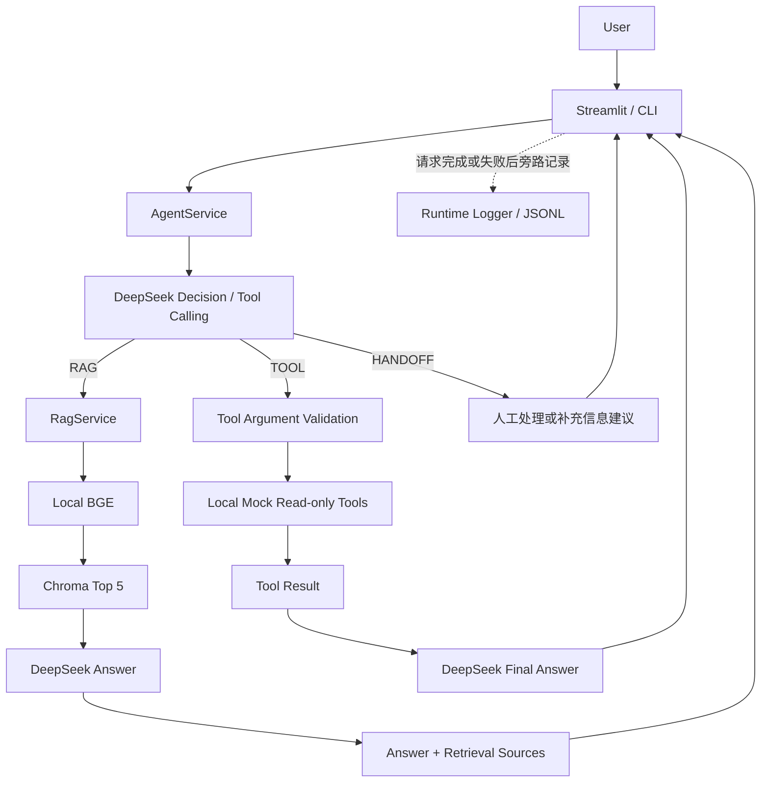

# AURA LABS AI Customer Service Agent

面向虚构电商品牌的可评测 AI 客服 Agent Demo，将企业知识 RAG、实时状态 Tool Calling、HANDOFF、Streamlit 展示和本地 Eval 脚本组合成一个完整 AI 应用作品集。

**Portfolio Complete · Agent V1.1（冻结）· Streamlit MVP V0.1 · Runtime Logging V0.1**

## 项目简介

客服的三类问题需要不同的依据：企业政策查知识库，具体订单状态查业务工具，争议和无法执行的操作提示人工处理。本项目围绕这个区别实现与验证一条完整应用链路，而不只展示模型聊天效果。

品牌 AURA LABS、知识资料及订单数据均用于演示。**这是求职作品集 Demo，不是真实生产客服**，未连接淘宝、抖音、ERP、物流、支付或客服系统。

## 核心能力

| 能力 | 当前实现 |
|---|---|
| 企业知识 RAG | 6 份 Markdown、122 个片段；本地 BGE 向量化、Chroma Top 5、DeepSeek 回答及检索参考来源 |
| 订单 / 退款查询 | DeepSeek Tool Calling 选择 `get_order_status` / `get_refund_status`，读取本地模拟数据 |
| HANDOFF | 人工处理或补充信息建议，不执行真实转接 |
| Streamlit / CLI | 共用现有 AgentService；网页保留 Session 展示历史，每题独立处理 |
| Eval | 检索、RAG 回答、Agent 行为分别评测；确定性评分，不增加 LLM 裁判 |
| Runtime Logging | 本地 JSONL 请求摘要，日志失败不影响回答，默认不存完整问题与回答 |

技术栈：Python、sentence-transformers（`BAAI/bge-small-zh-v1.5`）、Chroma、DeepSeek API（配置为 `deepseek-flash`）、Streamlit。`openai` 仅作兼容 SDK，实际请求 DeepSeek，不使用 OpenAI 模型。未使用 LangChain 或 LlamaIndex。

## System Architecture



模型决定路径和工具；代码校验工具白名单及参数；UI 与日志不重新判断意图。详细边界见 [Architecture](docs/ARCHITECTURE.md)。

## Evaluation

以下均为**已保存的固定测试集结果**，各项指标采用对应测试集与评分版本。

| 层次 / 测试规模 | 指标 | 结果 |
|---|---|---:|
| Retrieval / 80 条 | Top 1 来源命中率 | 64/80，80% |
| Retrieval / 80 条 | Top 3 来源命中率 | 75/80，93.75% |
| Retrieval / 80 条 | Top 5 来源命中率 | 76/80，95% |
| RAG / 80 条 | Final Answer Rule Pass Rate | 38/80，47.5% |
| Agent V1.1 / 40 条 | Path Accuracy | 40/40，100% |
| Agent V1.1 / 工具题 20 条 | Tool Selection Accuracy | 20/20，100% |
| Agent V1.1 / 工具题 20 条 | Argument Accuracy | 20/20，100% |
| Agent V1.1 / 人工及补充信息题 12 条 | Handoff Accuracy | 12/12，100% |
| Agent V1.1 / 40 条 | Final Answer Rule Pass Rate | 39/40，97.5% |

Top K 指标衡量预期**来源文件**是否被检索到，不是答案正确率。RAG 的 **47.5% 是自动规则通过率**，42 条失败尚未全部人工复核；不能全部归因于评分器，也不能直接称为 RAG 准确率。Agent 与 RAG 测试范围不同，分数不能互相替代。

Agent 当前唯一自动失败为 AG-006：合理的同义拒答未命中规则候选表达，保留原始成绩。固定集上的 100% 路径成绩不能外推到真实流量。已完成的离线检查为 **88 项通过**。

结果入口：[RAG 完整基线](eval/results/baseline_v1_2/rag_eval_summary.json)、[Agent V1.1 完整基线](eval/agent_v1_1/agent_eval_summary.json)。口径与版本见 [PROJECT_STATUS.md](PROJECT_STATUS.md)。

## Agent V1 → V1.1

V1 暴露了实时状态查询的工具优先级问题。V1.1 仅加强 Tool 使用优先级、增加临时 API 重试，并修正技术故障归类与请求计数；未更换知识库、向量模型、Top K、工具或测试集。没有为 AG-006 / AG-037 改变合理行为或放宽回答评分。

完整过程、失败案例和归因限制见 [Case Study](docs/CASE_STUDY.md)。

## Demo

在 Streamlit 依次输入，下方展开“查看 Agent 执行详情”：

| 问题 | 应观察的内容 |
|---|---|
| 洁面多少钱？ | RAG 回答与真实检索参考来源 |
| 订单 123456 到哪里了？ | `get_order_status`、参数与**本地模拟数据** |
| 123456 退款到账了吗？ | `get_refund_status`；模拟结果为退款处理中、尚未到账 |
| 我要人工客服。 | HANDOFF 人工处理建议，不能表示已经接通人工 |

## Quick Start

只查看项目，可先读本文与 [Case Study](docs/CASE_STUDY.md)，技术细节见 [Architecture](docs/ARCHITECTURE.md)。GitHub 和 ZIP 提供源码、知识原文与评测证据，不是在线聊天服务。

亲自运行请按以下顺序操作。命令适用于 Windows PowerShell，在包含 `app.py` 的项目根目录执行；完整步骤、验证环境和排错见 [本地运行说明](docs/RUNNING.md)。

```powershell
# 1. 新环境：安装依赖；已有可用环境则跳过
python -m venv .venv
.\.venv\Scripts\python.exe -m pip install -r requirements.txt

# 2. 复制配置模板，并在 .env 中填写自己的 DeepSeek 密钥
if (-not (Test-Path .env)) { Copy-Item .env.example .env }
```

```dotenv
DEEPSEEK_API_KEY=填写自己的密钥
DEEPSEEK_BASE_URL=https://api.deepseek.com
DEEPSEEK_MODEL=deepseek-flash
```

```powershell
# 3. 仅没有数据库的新环境执行一次：下载/加载 BGE，生成本地知识索引
.\.venv\Scripts\python.exe scripts/build_vector_store.py

# 4. 启动网页，按终端地址访问，默认 http://localhost:8501
.\.venv\Scripts\python.exe -m streamlit run app.py

# 或使用命令行，exit / quit 退出
.\.venv\Scripts\python.exe scripts/test_agent.py
```

知识原文与建库脚本均已提供，**不需要作者电脑上的模型缓存或数据库**。首次加载 BGE 需要访问 Hugging Face，程序将模型保存在 `.model_cache/`；建库将当前六份 Markdown 转成 `chroma_db/` 中的 122 条记录，不调用 DeepSeek。已有可用数据库时跳过第 3 步，日常启动不重建，不默认使用 `--rebuild`。

完整问答需要有效 DeepSeek 密钥、可用模型与额度，会产生 API 费用。`.env`、虚拟环境、模型缓存、数据库与运行日志均不进入 Git。依赖尚未完整锁定，环境信息和验证范围见运行说明。

离线检查（不调用 DeepSeek、不加载 BGE、不连接 Chroma）：

```powershell
.\.venv\Scripts\python.exe -m unittest discover -s tests -v
```

## Project Structure

```text
aura-rag-customer-service/
├── app.py                 # Streamlit 展示入口
├── src/                   # Agent、RAG、工具、客户端、评测规则、日志
├── scripts/               # CLI 与检索 / RAG / Agent 评测入口
├── knowledge_base/        # 6 份企业知识 Markdown
├── chroma_db/             # 本地 122 条记录，不进入 Git
├── eval/                  # 固定测试集与保留的历史基线
├── tests/                 # 离线单元与界面检查
├── logs/                  # JSONL 运行摘要，不进入 Git
├── docs/                  # 产品需求、架构与案例说明
├── PROJECT_STATUS.md      # 项目事实与版本记录
├── requirements.txt
└── .env.example
```

## Limitations

工具只读本地模拟数据；没有真实身份认证、订单授权或人工转接；没有多轮 Agent Memory。路由具有概率性，规则评分不能覆盖完整语义。检索来源只是参考，不代表逐句证据验证。最小日志不保证落盘，没有生产监控；当前不是生产系统。

## Documentation

- [Running：安装、首次建库与排错](docs/RUNNING.md)
- [PRD：产品需求与验收标准](docs/PRD.md)
- [Case Study：问题、迭代与失败分析](docs/CASE_STUDY.md)
- [Architecture：流程、模块与边界](docs/ARCHITECTURE.md)
- [PROJECT_STATUS：版本、测试基线与运行说明](PROJECT_STATUS.md)
