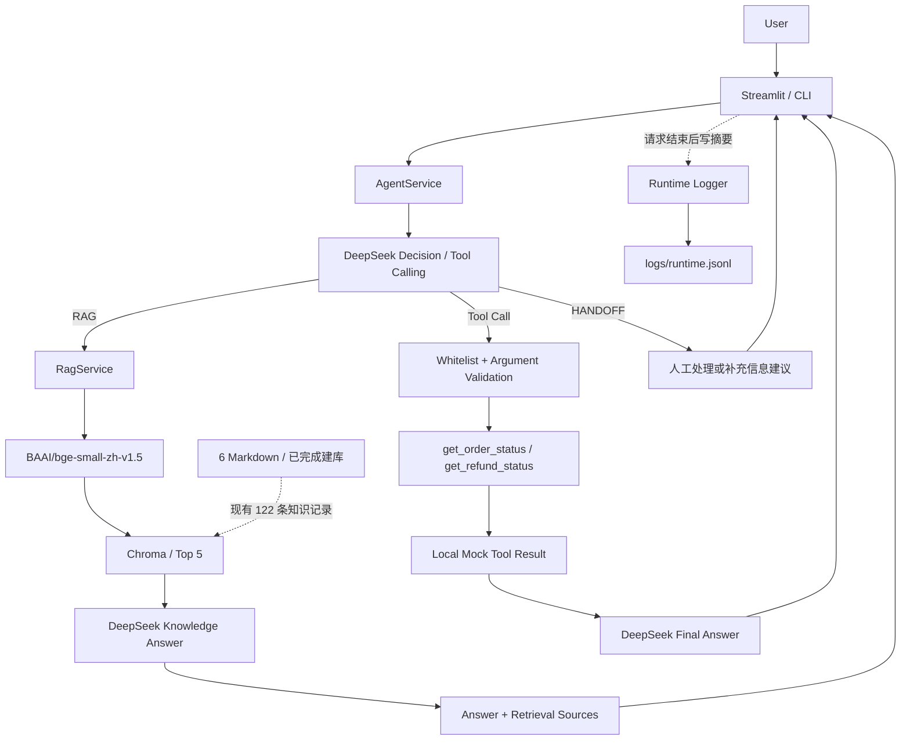

# AURA LABS AI Customer Service Agent — Architecture

事实依据：[PROJECT_STATUS.md](../PROJECT_STATUS.md)。当前实现：**Agent V1.1（冻结）＋ Streamlit MVP V0.1 ＋ Runtime Logging V0.1**。本文描述现有单进程 Python 应用的结构与边界。

## 1. Architecture Overview

实线表示请求处理，虚线表示已有知识的数据关系或旁路记录。正常请求使用现有 Collection `aura_customer_service`，不重新切分、建库或向量化全部知识。Streamlit 在当前 Session 首次提交时初始化服务，之后复用。新环境需先用公开 Markdown 和建库脚本生成本地索引；模型缓存首次下载，无需复制作者的本地数据。步骤见 [本地运行说明](RUNNING.md)。

三个路径的核心区别是事实来源与权限：RAG 使用静态企业资料；Tool 使用本地模拟的订单/退款状态；HANDOFF 提示超出当前能力的处理方式。后两者不代表已接入真实业务系统或人工队列。

## 2. Request Flow

### RAG Flow

**User → Agent Decision → RagService → BGE Query Embedding → Chroma Top 5 → DeepSeek → Answer + Retrieval Sources**

1. 展示层将本次原始问题传给 `AgentService.answer_question()`，不传聊天历史。DeepSeek 接收决策指令和两个工具的描述，选择 RAG 后复用现有 `RagService`。
2. 查询调用 `embed_query()`，模型为本地 CPU 加载的 `BAAI/bge-small-zh-v1.5`。查询增加既定检索前缀，文档与查询均归一化；建库文档输入为标题和正文。
3. 向现有 Chroma 显式提供 `query_embeddings`，按 cosine 距离取 Top 5，不使用 Chroma 默认向量模型。Collection 中已有 122 个片段。
4. 用户问题、客服规则、片段的 `source_file`、`heading`、`chunk_id`、`document` 发给 DeepSeek。资料不足不得补写企业事实，医疗问题不诊断或推荐药物。
5. 程序根据实际检索结果生成参考来源列表，模型生成最终回答。无片段时在本地拒答，不调用回答 API。

“检索参考来源”说明本次取回了什么，不证明模型逐条采用，也不证明每一句都获得来源支持。当前没有 reranker、混合检索或逐句证据核验。

### Tool Flow

**User → Agent Decision → Tool Call → 参数校验 → 本地模拟 Tool → Tool Result → DeepSeek Final Answer**

1. DeepSeek 根据问题和 Tool JSON Schema 返回 Tool Call；不是由 UI 或关键词分支决定。V1.1 的指令与描述要求：已有足够订单号的实时状态问题必须查询，用户不能要求跳过工具来猜测到账或物流状态。
2. 程序只执行白名单函数，仅接受 `order_id`：6～20 位 ASCII 数字字符串，必须出现在本次输入中，不允许额外字段、编造订单号或执行任意代码。这是输入约束，不是身份认证。
3. `get_order_status` 返回订单及物流字段；`get_refund_status` 返回退款状态、金额与申请时间。数据来自固定本地字典，均带 `is_mock=true`。未预置订单返回 `found=false` 和“未找到订单”。
4. 以原 `tool_call_id` 将结果作为 `role="tool"` 消息回传，DeepSeek 在 `tool_choice="none"` 下生成回答。程序保留本地模拟数据标记。

当前最多一轮工具执行，同轮最多两个调用。两个工具均只读，不能修改订单、执行退款、承诺补发或赔偿。

### HANDOFF Flow

**User → Agent Decision → HANDOFF → 人工处理 / 补充信息提示**

人工请求、投诉争议、当前不可执行的操作或缺少订单号等，由模型选择现有 HANDOFF 流程，生成建议或请求补充信息。没有真实人工队列、工单状态或转接动作，页面不得把这条路径表述为已经接通人工。

### 共享请求能力

DeepSeek 通过兼容的 `openai` SDK 请求 `https://api.deepseek.com`，模型从环境变量读取，已测配置为 `deepseek-flash`。不调用 OpenAI 模型。

V1.1 对 timeout、HTTP 429/500/502/503/504 最多额外重试两次，等待 1 秒、2 秒；401/402/422 等配置、余额或参数错误不盲目重试。SDK 内置重试关闭，避免叠加。重试不修改上下文和业务选择。

Streamlit 与 CLI 在请求完成或失败后调用日志辅助模块，追加一条 JSONL 摘要。普通 UI rerun、历史重绘、CLI 空输入与退出不写请求日志。记录真实路径、状态和耗时，异常没有结果时路径为 null，不猜测部分轨迹。

## 3. Module Responsibilities

| 模块 | 负责 | 不负责 |
|---|---|---|
| `src/agent_service.py` | 请求模型决策、验证工具调用、回传工具结果、复用 RAG、组织 AgentResult | 不维护多轮记忆，不执行任意模型代码，不实现真实人工队列 |
| `src/rag_service.py` | 组合检索内容与原有客服规则，调用回答模型，返回回答与实际参考来源 | 不查实时订单，不重新定义 Agent 路由 |
| `src/retriever.py` | 打开现有知识集合、以查询向量检索并整理片段 | 不重建知识库，不生成最终客服答案 |
| `src/embeddings.py` | 统一 BGE 加载、文档/问题向量和既定预处理 | 不调用 DeepSeek 生成向量，不作意图路由 |
| `src/vector_store.py` | Chroma 本地连接与既有建库支持；日常链路使用现有库 | 不在正常查询中自动重建或修改 122 条记录 |
| `src/deepseek_client.py` | 环境配置、模型请求、有限重试与清晰错误 | 不定义 UI，不决定日志内容，不提供真实业务数据 |
| `src/tools.py` | 两个只读模拟函数及供模型选择的工具描述 | 不连接电商平台，不执行退款或订单修改 |
| `src/runtime_logger.py` | 生成时间/请求 ID，安全追加本地 JSONL 摘要，隔离写入错误 | 不影响路径、参数或回答，不存聊天历史，不调用模型 |
| `app.py` | Session 内复用服务、展示聊天和真实执行详情、提交后写摘要 | 不按关键词路由，不绕过 AgentService，不把历史传给模型 |

`scripts/test_agent.py` 是另一个入口，按相同方式初始化并调用服务；`scripts/eval_*` 和评分模块独立验证检索、回答及行为，不成为线上请求路由。

## 4. Design Boundaries

- **模型选择，代码验证。** DeepSeek 决定 RAG / Tool / HANDOFF；程序执行白名单、参数格式、当前输入来源校验。校验可以限制非法执行，不能保证模型永远选对意图。
- **查询与操作分开。** Tool 只读。退款状态查询不等于批准退款，更不等于钱已到账；回答必须依据实际模拟结果。
- **静态知识与具体状态分开。** 通用退货政策走 RAG，指定订单退款进度走 Tool；缺信息或权限范围之外的需求走现有人工/补充信息提示。
- **展示层不重复决策。** Streamlit 与 CLI 使用同一个 AgentService。UI 的折叠详情展示已返回的数据，不伪造 Trace、真实接口或逐请求重试字段。
- **日志是旁路。** 默认不存完整问题、回答、Prompt、知识正文或完整工具结果。`success` 仅指正常返回，不等于 Eval 通过；写盘失败不改变原回答，不新增 API 请求。
- **计数不混用。** 日志可用客户端累计值差记录真实 `api_attempts`，包含重试；未知则省略。当前没有完整逐请求 API / retry telemetry，不能把尝试数当作逻辑调用数或 retry_count。
- **来源只是检索参考。** 来源清单由程序生成，避免编造文件名；没有因此完成逐句引用验证。
- **每次请求独立。** Session 聊天记录只是显示历史，不是 Agent Memory；订单号必须来自本次输入。request_id 不建立用户画像。

已保存的验证证据包括：80 条 Retrieval（Top 5 来源命中 76/80，95%）、80 条 RAG（规则通过 38/80，47.5%）、40 条 Agent V1.1（路径 40/40、工具及参数各 20/20、HANDOFF 12/12，最终回答规则通过 39/40，97.5%）。最近已完成的离线检查为 88 项通过。这些不同口径不能相互替代，也不证明生产准确率。

## 5. Why This Architecture

当前范围是小型学习与求职 Demo：一个知识库、两种只读查询、三条路径。直接 Python 模块足以说明数据如何进入模型、工具如何执行、结果如何返回，便于理解与定位错误。

| 当前未采用 | 本项目范围下的选择理由 |
|---|---|
| LangChain | 所需检索、模型请求和工具回传已能直接表达，暂不增加框架抽象与依赖 |
| Multi-Agent | 没有多个独立角色协作的需求，单个 Agent 的三类路径即可覆盖范围 |
| GraphRAG | 当前任务以产品/政策片段检索为主，没有已验证的图关系检索需求 |
| 微服务 | 本地 Demo 没有独立扩缩容或服务治理要求，单项目更便于运行与演示 |

这是范围与可解释性之间的工程选择，不代表这些技术没有价值。也没有做不同框架、Embedding 或 Top K 的系统对比，不能宣称当前组合最优。

## 6. Production Evolution

**以下全部为 Not Implemented / Future Work，未实现，不属于当前交付范围。**

| 未来方向 | 走向真实业务前需要解决的问题 |
|---|---|
| 真实订单、物流、售后 API | 将模拟数据替换为授权接口，明确超时、错误与业务状态的真实含义 |
| 身份与权限 | 核验用户身份和订单归属，不能以“知道订单号”代替授权 |
| 人工工单或客服队列 | 区分建议人工处理、已提交、已接通和已完成，依据接口状态展示 |
| 写操作确认 | 若扩展退款等操作，需权限、明确确认、防重复执行和结果核验；不能沿用只读查询的权限假设 |
| 生产日志与监控 | 按数据最小化原则补充访问控制、可靠存储、轮转、告警和必要调用统计 |
| 真实流量 Eval | 对经授权处理的实际问题建立代表性验证，人工复核风险与评分误判，再决定是否优化检索或路由 |

更完整的案例、历史成绩与局限见 [Case Study](CASE_STUDY.md)；实际启动说明见 [README](../README.md)。
