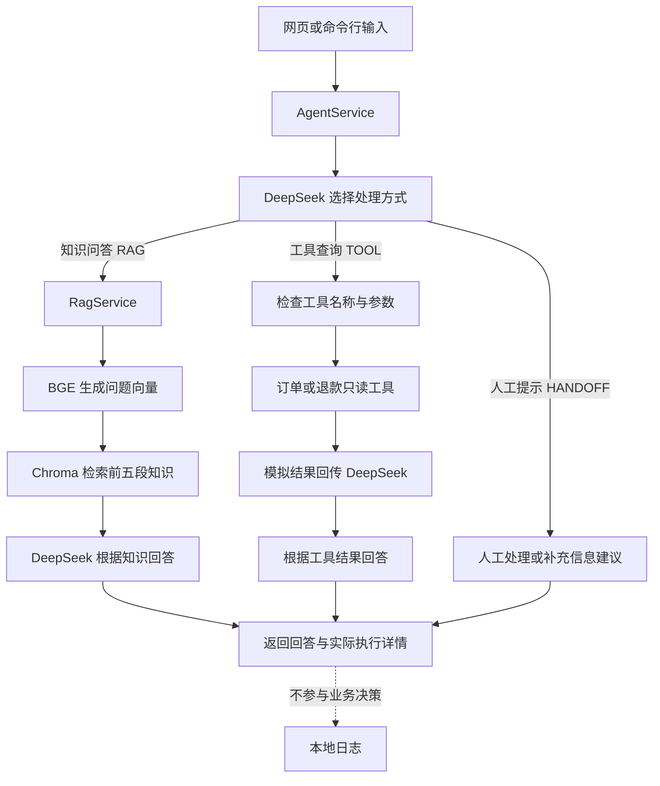

# AURA LABS · 架构说明

**Agent V1.1 · Streamlit 展示页面 V0.1 · 本地运行日志 V0.1**

本文说明请求如何处理，以及模型、程序和工具各自负责什么。完整配置与历史结果见 [项目状态](../PROJECT_STATUS.md)，本地启动见 [运行指南](RUNNING.md)。

## 1. 总体架构

网页和命令行都调用 AgentService。DeepSeek 先判断需要企业知识、具体状态还是人工处理，再由程序执行对应流程。

已有环境直接查询 Collection `aura_customer_service`，正常请求不建库。新环境用仓库提供的知识原文和建库脚本生成索引。Streamlit 在当前会话第一次提交时创建服务，后续复用。

## 2. 企业知识问答：先找资料，再组织答案

示例：“我打开洁面用了两次还能退吗？”

1. DeepSeek 选择 RAG，将原问题交给已有 RagService。
2. 本地 BGE 把问题转成向量，即用于比较文本语义的一组数字。
3. Chroma 比较问题向量与知识向量，返回最相关的五个片段，称为 Top 5。
4. 程序把问题、客服规则和片段一起交给 DeepSeek。模型根据资料回答，程序另外整理实际检索来源。

### 向量与片段怎样保持一致

| 配置 | 实际处理 |
|---|---|
| 向量模型 | CPU 加载 `BAAI/bge-small-zh-v1.5`，不调用 DeepSeek 生成向量 |
| 文档输入 | 标题与正文 |
| 问题输入 | 前缀 `为这个句子生成表示以用于检索相关文章：` 加用户问题 |
| 向量归一化 | 文档与问题均使用 `normalize_embeddings=True`，把向量长度调整为 1，方向不变 |
| 检索方式 | 显式传入 `query_embeddings`，由 Chroma 使用 cosine（余弦）距离比较方向；距离越小越靠前 |
| 知识规模 | 6 份 Markdown、122 个片段 |
| 来源字段 | `source_file` 文件名、`heading` 标题、`chunk_id` 片段编号、`document` 正文 |

来源清单表示这次检索到了什么，不保证模型采用了每段，也没有逐句证据核验。无可用片段时本地拒答；片段内容不足时应说明无法确认，不补充企业事实。医疗问题不诊断或推荐药物。

当前没有重排序模型、关键词混合检索或逐句引用验证。

## 3. 订单与退款查询：模型选择，程序校验

示例：“订单 123456 退款到账了吗？”

1. 程序向 DeepSeek 提供问题、系统指令和两个工具的 JSON Schema。Schema 是工具说明，描述名称、用途和参数格式。
2. `tool_choice="auto"` 允许模型选择是否调用。需要工具时，模型返回 Tool Call，即调用请求；模型本身不直接运行 Python 函数。
3. 程序校验工具与参数，通过后运行本地只读函数。
4. 结果以 `role="tool"` 消息回传，并带上对应的 `tool_call_id`，让模型知道结果属于哪次调用。
5. DeepSeek 根据结果回答，最终生成阶段使用 `tool_choice="none"`，不继续选择新工具。

### 执行前检查

- 工具必须是 `get_order_status` 或 `get_refund_status`。
- 只接收 `order_id`，不允许多余字段。
- 订单号必须为 6～20 位 ASCII 数字字符串，即普通的 `0～9`，并且出现在本次输入中。
- 不猜编号，不沿用上轮订单号，不执行模型提出的任意代码。

这些检查限制非法执行，不能代替身份认证或订单归属授权，也不能保证模型始终选对工具。

### 工具与结果

| 工具 | 返回内容 |
|---|---|
| `get_order_status` | 订单状态、物流公司、单号与最新位置 |
| `get_refund_status` | 退款状态、金额与申请时间 |

两者读取固定本地字典，返回 `is_mock=true`，表示模拟数据。不存在的订单返回 `found=false` 和“未找到订单”，不能补一个物流或退款状态。工具不改订单、不执行退款或赔偿。

已有充分订单号的具体状态问题，不能被“别查系统”“假装到账”等指令绕过。此要求写入系统指令和工具描述，仍由模型判断，不用关键词代码替代决策。最多执行一轮工具调用，同轮最多两个。

## 4. 人工处理或补充信息提示

人工请求、投诉争议、当前不能执行的操作，以及缺少订单号等情况，可由模型选择 HANDOFF。系统给出人工处理建议或说明需要补充什么。

当前没有人工队列、工单或接通接口，因此这条路径不表示已经转接成功。

## 5. 模块职责

| 模块 | 负责什么 | 主要边界 |
|---|---|---|
| `agent_service.py` | 请求模型决策，校验与回传工具结果，复用 RAG | 不维护多轮记忆 |
| `rag_service.py` | 组织知识上下文，生成回答与来源 | 不查具体订单 |
| `retriever.py` | 打开已有知识集合并检索 | 不建库、不生成客服答案 |
| `embeddings.py` | 加载 BGE，统一文档和问题的向量处理 | 不请求生成 API |
| `vector_store.py` | 连接 Chroma，支持明确执行的建库步骤 | 正常查询不重建知识记录 |
| `deepseek_client.py` | 读取配置、请求模型、处理有限重试与错误 | 不提供业务事实 |
| `tools.py` | 两个只读模拟工具及描述 | 不连接真实平台或写业务数据 |
| `runtime_logger.py` | 追加本地请求摘要，隔离写入失败 | 不选择路径、不修改回答 |
| `app.py` / `scripts/test_agent.py` | 网页与命令行交互 | 共用服务，不重新路由、不传入历史 |

评测脚本 `scripts/eval_*` 与评分模块检查结果，不参与正常请求的业务决策。

## 6. 模型请求与重试

模型名从环境变量读取，已测配置为 `deepseek-flash`。兼容 SDK 请求 `https://api.deepseek.com`，不调用 OpenAI 模型。

对 timeout、HTTP 429/500/502/503/504 最多额外重试两次，先等 1 秒、再等 2 秒。SDK 内置重试关闭，避免两套重试叠加。401/402/422 等配置、余额或参数错误不盲目重试；重试不修改问题和上下文。

## 7. 网页历史与运行日志

### 历史只用于展示

UI 只展示实际返回的数据。当前浏览器会话（Session）可以显示历史、复用服务，但每次只将当前问题传给 Agent，没有多轮记忆或订单号继承。

### 日志记录什么

网页与命令行只在实际新请求结束时写一条 JSONL 记录。JSONL 是每行一个 JSON 对象的文件格式。页面重绘、空输入和退出命令不新增请求日志。

日志保存时间、请求编号、入口、实际路径、正常返回状态和耗时，以及已有的工具摘要。默认不保存完整问答、问题预览、提示词、知识正文、完整工具结果或密钥；错误仅存安全摘要。异常未返回结果时路径为 `null`，表示未知，不推断中间轨迹。

`success=true` 表示程序正常返回，不等于答案正确；未找到订单或人工处理提示也可以正常返回。

### API 次数怎样理解

只在计数器可读时，记录本次处理前后累计 `api_attempts` 的差值。这是实际尝试次数，包含正常调用和重试。例如一次决策加一次回答都成功，次数也是 2，并不表示重试两次。

未知次数不填写；目前没有可靠的独立 `retry_count`（重试次数）或完整逐请求调用统计，页面也不显示这些计数字段。

### 日志不影响业务

写入失败不会改变原路径、参数或回答，不重试 Agent，也不增加 API 请求。日志不提交 Git，没有后台队列、自动轮转或跨进程事务保证，不属于完整生产监控系统。

## 8. 为什么保持这套结构

一个知识库、两个只读工具和三种处理方式，直接用 Python 模块就能清楚实现与排查。当前没有已验证的多角色协作、图关系检索或独立扩缩容需求，因此没有加入 LangChain、Multi-Agent、GraphRAG 或微服务。

这是项目范围下的工程选择，不代表这些技术没有价值，也没有证明当前模型或 Top K 最优。

## 9. 验证证据与未来方向

已保存结果：80 条检索题的 Top 5 来源命中 76/80（95%）；80 条 RAG 回答规则通过 38/80（47.5%）；40 条 Agent 题路径 40/40、工具及参数各 20/20、人工路径 12/12，最终回答规则通过 39/40（97.5%）。离线检查 88 项通过。口径和失败分析见 [项目案例](CASE_STUDY.md)，不同指标不能合并为生产准确率。

真实业务 API、身份与订单授权、人工工单、写操作确认与防重复、生产监控及真实流量评测，均为未实现的未来方向。应先明确业务需求和验证证据，再决定是否增加组件。
