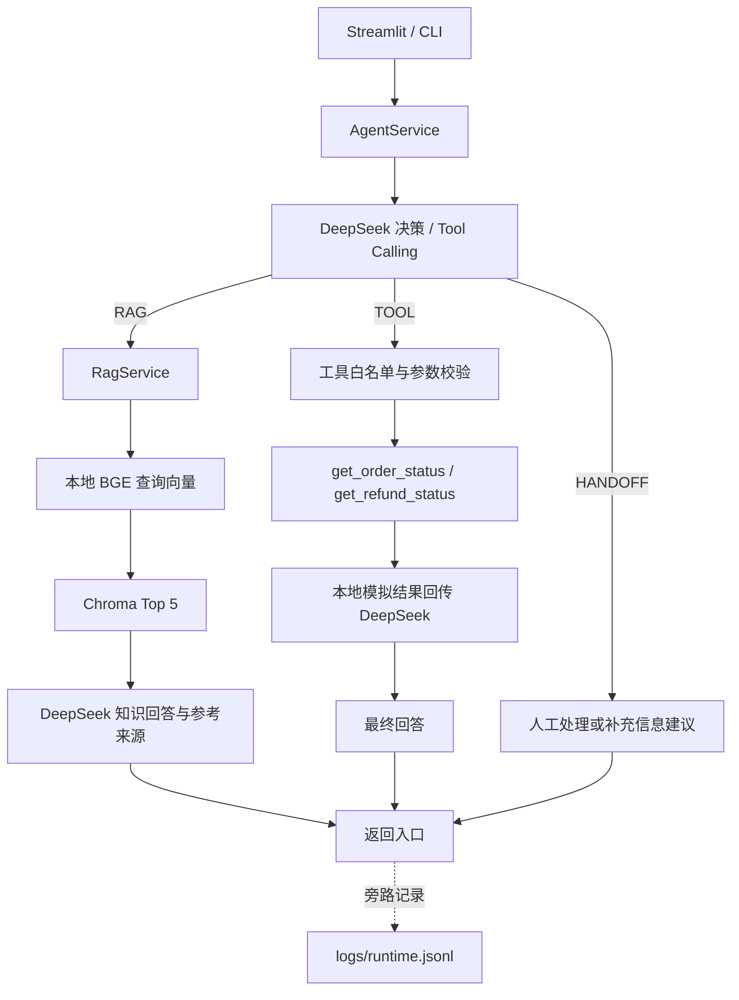

# AURA LABS · 架构说明

**Agent V1.1（冻结）· Streamlit MVP V0.1 · Runtime Logging V0.1**。配置与历史结果见 [项目状态](../PROJECT_STATUS.md)。

## 1. 总体架构

正常请求复用现有 `aura_customer_service`，不重新建库。新环境用公开 Markdown 和建库脚本生成索引，首次下载模型；步骤见 [Running](RUNNING.md)。Streamlit 首次提问时初始化服务，Session 内复用。

## 2. 三条请求路径

### RAG

原问题 → 模型选 RAG → RagService → BGE 查询向量 → Chroma Top 5 → DeepSeek 回答。

- 6 份 Markdown、122 个片段；模型为 CPU 加载的 `BAAI/bge-small-zh-v1.5`。
- 文档输入为标题与正文；查询加前缀 `为这个句子生成表示以用于检索相关文章：`，两者均归一化。
- 向 Chroma 显式提供 `query_embeddings`，使用 cosine 距离，不用默认向量模型。
- 上下文包含问题、客服规则及每段的 `source_file`、`heading`、`chunk_id`、`document`。来源清单由程序从实际检索结果生成，不是逐句证据核验。
- 无片段时本地拒答；资料不足不编企业事实，医疗问题不诊断或推荐药物。没有重排、混合检索或逐句引用验证。

### TOOL

模型返回 Tool Call → 程序校验 → 本地只读函数 → `role="tool"` 回传 → DeepSeek 最终回答。

- 首次使用 `tool_choice="auto"`，结果以原 `tool_call_id` 回传，最终生成用 `tool_choice="none"`。
- 仅允许两个工具及 `order_id`，要求 6～20 位 ASCII 数字字符串且来自本次输入，拒绝多余字段；这不是身份认证。
- 订单工具返回状态、物流公司、单号、位置；退款工具返回状态、金额、申请时间。均为固定模拟字典、`is_mock=true`，不存在则 `found=false` / “未找到订单”。
- 已有充分订单号的实时查询不能被“别查系统”“假装到账”绕过；优先级通过指令和工具描述表达，不用关键词路由。
- 最多一轮执行、同轮最多两个调用，不执行退款、修改或赔偿操作。

### HANDOFF

模型选择 HANDOFF → 人工处理或补充信息建议。适用于人工请求、投诉争议、不能执行的操作及缺订单号等情况；没有真实队列、工单或接通动作。

## 3. 模块分工

| 模块 | 职责与边界 |
|---|---|
| `agent_service.py` | 模型决策、工具校验/回传、复用 RAG；不维护多轮记忆 |
| `rag_service.py` | 组合知识上下文、生成回答与来源；不查实时订单 |
| `retriever.py` | 打开已有 Collection 并检索；不建库、不生成客服答案 |
| `embeddings.py` | 统一 BGE 加载与向量处理；不调用生成 API |
| `vector_store.py` | Chroma 连接及建库支持；查询时不重建记录 |
| `deepseek_client.py` | 配置、模型请求、有限重试与错误处理 |
| `tools.py` | 两个只读模拟工具及 Schema；不连接平台或写业务数据 |
| `runtime_logger.py` | 安全追加 JSONL，隔离写入失败；不参与决策 |
| `app.py` / `scripts/test_agent.py` | 两个入口调用同一服务；不自行路由或把历史传给模型 |

`scripts/eval_*` 与评分模块独立检查检索、回答和行为，不加入正常请求决策。

## 4. 请求、日志与边界

DeepSeek 从环境变量读取模型，已测为 `deepseek-flash`，兼容 SDK 请求 `https://api.deepseek.com`，不调用 OpenAI 模型。timeout、429/500/502/503/504 最多额外重试两次，等待 1、2 秒；SDK 重试关闭，401/402/422 等不盲目重试，重试不改变上下文。

| 边界 | 约束 |
|---|---|
| 模型与代码 | 模型选择路径和工具，程序校验白名单与参数；校验不能保证意图一定选对，也不等于订单授权 |
| 静态与实时数据 | 通用规则走 RAG，指定状态查工具，无法执行的操作只给处理建议 |
| 展示与记忆 | UI 只显示真实返回字段；Session 历史仅展示，每题独立，不继承订单号 |
| 来源含义 | 是本次检索参考，不保证逐段使用或逐句支持 |
| 日志隔离 | 新请求结束时写一条，重绘/空输入/退出不写；失败不改回答、不重试 Agent、不新增 API 请求 |

日志默认不存完整问答、preview、Prompt、知识正文、完整工具结果或密钥；错误仅存安全摘要。未取得结果时路径为 null。`success` 表示正常返回，未找到订单或 HANDOFF 也可为 true，不代表 Eval 通过。

只在可读计数器时记录真实 `api_attempts` 差值，包含重试；未知省略。没有准确独立 retry_count 或完整 telemetry，没有后台队列、轮转或跨进程事务保证。真实日志不进 Git。

## 5. 选型理由

一个知识库、两个只读工具、三条路径，用直接 Python 模块即可表达和排查。没有角色协作、图关系检索或独立扩缩容的已验证需求，因此未采用 LangChain、Multi-Agent、GraphRAG 或微服务；这不代表这些技术没有价值，也未证明当前模型或 Top K 最优。

## 6. 验证与演进

80 条 Retrieval：Top 5 来源命中 76/80（95%）；80 条 RAG：规则通过 38/80（47.5%）；40 条 Agent：路径 40/40、工具/参数各 20/20、HANDOFF 12/12，最终回答规则通过 39/40（97.5%）。离线检查 88 项通过。口径与失败分析见 [Case Study](CASE_STUDY.md)，不能合并为生产准确率。

**未实现的后续方向：** 真实业务 API、身份与订单授权、人工工单、写操作确认与防重复、生产日志监控、真实流量 Eval。应先明确业务边界与验证证据，再决定是否增加组件。
