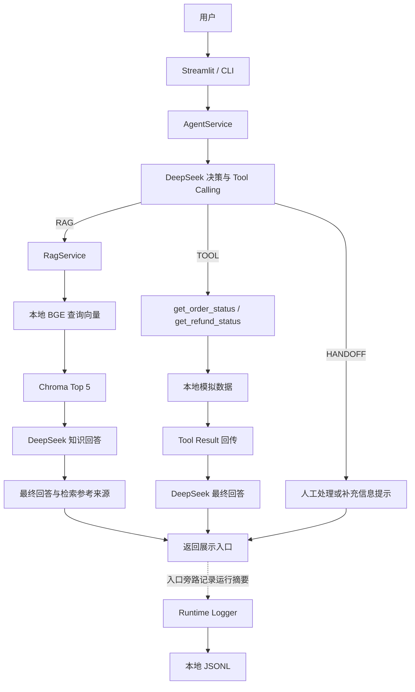

# AURA LABS AI 电商客服 Agent

**Project Case Study V0.1 · 求职作品集案例**

事实快照：2026-10-20。本文仅依据 [PROJECT_STATUS.md](../PROJECT_STATUS.md) 整理，不新增功能或重跑评测。当前实现为 **Agent V1.1（冻结）＋ Streamlit MVP V0.1 ＋ 本地运行日志 V0.1**。

## 1. 项目概览

这是虚构男士护肤品牌 **AURA LABS 的 AI 电商客服求职作品集 Demo**。品牌资料、订单与退款记录均用于演示，不代表真实商家的经营数据。

项目从企业知识问答出发，逐步完成 RAG、模型工具调用、评测、展示界面和最小运行日志。目标是让每类请求有清楚的数据依据与处理边界，并能够用测试检查系统表现，而不只展示几次流畅的聊天。

| 项目要素 | 当前实现 |
|---|---|
| 使用场景 | 产品、物流与退换货知识问答；指定订单的模拟状态查询；人工处理建议 |
| 知识范围 | 洁面、控油精华、修护面霜及相关客服规则 |
| 核心能力 | RAG 企业知识问答＋两个只读工具＋HANDOFF |
| 演示入口 | Streamlit 与命令行，共用 AgentService |
| 验证方式 | 检索评测、RAG 规则评测、Agent 行为评测、离线单元检查 |
| 运行记录 | 本地 JSONL 摘要日志 |

当前成果是可演示、可检查的学习项目，不是已上线的生产客服系统。没有真实平台接入、退款执行或人工队列。

## 2. 我想解决什么问题

我把客服问题拆成三类，因为它们需要不同的事实来源和处理权限。

| 产品问题 | 直接让模型回答的风险 | 本项目的对应设计 |
|---|---|---|
| 企业知识需要受控来源 | 可能用模型记忆补写价格、政策或未公开信息 | RAG：检索企业知识后回答，资料不足时说明无法确认 |
| 指定订单状态需要查询 | 静态知识无法说明某个订单现在在哪里、退款是否到账 | TOOL：由模型选择只读工具，按实际模拟结果回答 |
| 部分需求涉及动作或争议 | 回答能力容易被误解为有退款、改地址或裁决权限 | HANDOFF：给出人工处理或补充信息建议，不宣称已完成操作 |
| 系统表现需要验证 | 几个演示问题回答正确，无法证明路径、参数和边界都正确 | 分开评测检索、回答规则与 Agent 行为，保留失败记录 |

例如，通用的“广州多久到”属于知识问题；“订单 123456 到哪里了”属于指定订单查询；投诉争议或要求修改地址则超出当前只读工具能力。划分依据是请求需要什么数据和权限，而不是只看它是否包含“订单”或“退款”。

这是对演示产品的设计判断，没有据此编造人工客服节省比例、真实服务量或商业收益。

## 3. 项目范围与边界

当前支持企业知识问答、模拟订单状态查询、模拟退款状态查询、人工处理提示、Streamlit 演示、本地评测脚本与离线规则检查，以及本地运行摘要日志。

需要特别区分：**离线单元与规则检查不调用模型；完整 RAG/Agent 端到端评测会请求 DeepSeek API。** 本地执行评测脚本不等于整个评测离线运行。

| 能力边界 | 当前事实 |
|---|---|
| 企业知识 | 使用用户提供的虚构品牌 Markdown，不自行补写企业事实 |
| 订单与退款 | 工具读取本地固定字典，不连接淘宝、抖音、ERP、真实物流或支付系统 |
| 业务操作 | 不修改订单、不发起退款、不更改售后审核结果 |
| 人工处理 | 返回建议或补充信息提示，没有真实客服队列、工单或转接接口 |
| 身份与权限 | 未实现用户登录、身份认证或订单访问授权 |
| 对话历史 | 仅 UI Session 保存展示记录，Agent 每次问题独立处理 |
| 运行环境 | 求职 Demo，没有生产部署或生产级监控能力 |

医疗问题不进行诊断、不推荐药物；企业资料不足时应拒绝确认；工具没有找到订单时应说明未找到，不能生成一个看似合理的状态。

## 4. 系统架构

Streamlit 与 CLI 都调用同一个 `AgentService`。DeepSeek 先决定处理方式，程序再执行现有 RAG 或允许的工具，展示层不重新判断业务意图。

Runtime Logger 只接收运行摘要，不参与路由、参数选择或答案生成；成功和失败请求都可记录，日志失败也不改变业务响应。它是 Python 辅助模块，不是一个新的独立监控服务。

## 5. 为什么采用这套技术方案

**本地中文 BGE。** 企业知识与用户问题主要是中文，项目使用 `BAAI/bge-small-zh-v1.5`，由 `sentence-transformers` 在本地加载。向量化与生成职责分开，便于分别理解查询表示、检索结果和生成答案。这个选择没有被包装成模型横向评测中的最优结论。

**本地 Chroma。** `PersistentClient` 保存已建立的知识片段、metadata 和向量，让每次查询复用同一份本地知识库。它在这个小型 Demo 中承担持久化向量检索职责，不代表项目已经具备大规模向量平台的容量、运维或多租户能力。

**DeepSeek。** 当前配置为 `deepseek-flash`，用于 RAG 回答生成、Agent 路径与 Tool Calling 决策，以及工具结果返回后的最终回答。模型名通过环境变量读取。Python 使用 OpenAI 兼容 SDK，但请求的是 DeepSeek API；向量由本地 BGE 生成。

**直接 Python 模块调用。** 本项目没有使用 LangChain 或 LlamaIndex。当前规模下，直接组织模块与消息能看清问题、向量、知识上下文、工具参数和工具结果如何流动，也便于初学者定位问题。这个选择服务于项目的学习与演示范围，并不意味着框架没有价值。

## 6. RAG 设计

知识库由 6 个文件组成：产品资料 `products.md`、退换货 `returns.md`、物流 `shipping.md`、常见问题 `faq.md`、成分 `ingredients.md`、售后 `after_sales.md`。现有 Chroma Collection 为 `aura_customer_service`，共有 **122 个知识片段**。

切分优先保留标题、子标题、段落、列表项和完整句子的边界。最初希望片段约 300～600 字；当前实现默认目标上限为 600 字，不强制补足 300 字，也不为了长度跨标题硬拼。完整长句可能超过目标上限，当前没有额外重叠步骤。

检索与回答的数据流如下：

1. 文档向量使用标题与正文；查询向量使用用户问题，并加前缀 `为这个句子生成表示以用于检索相关文章：`。
2. 文档与查询均使用 `normalize_embeddings=True`，由同一本地 BGE 处理。
3. Chroma 使用 cosine 距离，显式接收查询向量，默认检索 **Top K = 5**，不使用 Chroma 默认向量模型。
4. 每个片段保留 `source_file`、完整标题路径 `heading`、`chunk_id` 和正文，随问题一起提供给 DeepSeek。
5. 模型按知识库约束回答；没有足够资料时说明无法确认。没有可用片段时，本地直接拒答，不发送空知识上下文。

程序根据实际检索 metadata 展示“检索参考来源”。这些来源说明本次检索到了什么，**不能证明模型逐条使用了这些片段，也不是逐句 citation**。

本案例展示的是基础向量检索；reranker、hybrid search 和 GraphRAG 均不作为已实现能力展示。保留当前方案有助于先建立可解释的基线，不把尚未引入的技术本身当作缺陷。

## 7. Agent 设计

Agent 有三个实际处理方向：

| 路径 | 适用情况 | 执行方式 |
|---|---|---|
| RAG | 产品、成分、通用物流、退换货政策等知识 | 原样复用现有 RagService |
| TOOL | 用户明确提供订单号，要求查询具体订单或退款状态 | 执行白名单内的只读工具，将结果返回模型 |
| HANDOFF | 人工请求、投诉争议、当前不能执行的操作，或订单号不足 | 生成处理建议或补充信息提示 |

首次请求设置 `tool_choice="auto"`，由 DeepSeek 决定是否调用工具及参数。代码没有用用户关键词把问题分配给 RAG、TOOL 或 HANDOFF。

程序负责确定性的执行边界：工具必须在白名单内，参数必须符合约定，订单号必须是用户本次提供的 6～20 位数字字符串。这样可以避免模型凭空构造一个格式正确的编号，或调用并不存在的业务操作；**这项校验不等于用户身份与订单归属授权**。

两个工具分别承担：

- `get_order_status(order_id: str)`：返回模拟订单状态、物流公司、单号和最新位置。
- `get_refund_status(order_id: str)`：返回模拟退款状态、金额和申请时间。

例如，本地记录中的 `123456` 正在运输，退款仍在处理中、尚未到账；不存在的编号返回“未找到订单”。这些数据是固定演示记录，不随真实业务变化。

工具结果通过对应 `tool_call_id` 返回模型，最终生成时使用 `tool_choice="none"`。当前最多一轮工具执行、同轮最多两个调用，没有无限工具循环或 Multi-Agent。工具只读，不执行退款、改地址或售后裁决。

## 8. Eval 设计

验证分成三层，每层回答不同问题，不能把分数合并成一个“AI 准确率”。

| 层次 | 测试规模 | 核心问题 |
|---|---:|---|
| Retrieval Eval | 80 条 | 预期来源有没有进入检索结果？ |
| RAG Eval | 80 条 | 最终回答有没有通过固定内容与行动规则？ |
| Agent Eval | 40 条 | 路径、工具、参数及回答是否符合预期？ |

### Retrieval Eval：来源进入 Top K

| 指标 | 命中数 | 比例 |
|---|---:|---:|
| Top 1 来源命中 | 64/80 | 80% |
| Top 3 来源命中 | 75/80 | 93.75% |
| Top 5 来源命中 | 76/80 | 95% |

这衡量的是“预期来源是否进入 Top K”，**不是回答准确率**。即便来源文件命中，检索出的具体段落是否足够、模型是否正确使用资料，仍需下一层检查。脚本还单独列出 Top 5 未命中，以及正确来源仅排第 4/5 名的案例，便于分析排序问题。

### RAG Eval：固定规则通过率

当前记录的完整历史基线使用 80 条测试，成功调用 80 条，回答规则通过 **38/80，即 47.5%**。结果记录为 `eval/results/baseline_v1_2/rag_eval_summary.json`，运行日期为 2026-10-19；状态文档记载其数据集哈希与当前 CSV 一致。

评分使用确定性规则，不调用另一个 LLM Judge：必要信息以分号划分概念组，同组竖线候选表达任一命中即可；禁含内容使用有限的中文近邻否定豁免；另检查回答、拒答、转人工等行动特征。`reference_answer` 用于人工对照，不作为答案上下文提供给模型。

**47.5% 只能称为自动规则通过率，不能写成“RAG 准确率只有 47.5%”。** 已有真实记录证明字符串匹配会误判；同时，历史 42 条失败尚未全部人工复核，当前无法量化其中多少属于误判，不能把它们全部归为评分器问题或模型错误。部分题目的复测也不能替代这份完整基线。

### Agent Eval：拆开行为与回答

40 条测试覆盖 RAG 8 条、订单工具 8 条、退款工具 7 条、不存在订单 4 条、HANDOFF 6 条、参数不足 3 条、对抗测试 4 条。按预期路径划分为 RAG 8 条、TOOL 20 条、HANDOFF 12 条。

| Agent V1.1 指标 | 结果 | 判定重点 |
|---|---:|---|
| Path Accuracy | 40/40，100% | 实际路径与预期路径一致 |
| Tool Selection Accuracy | 20/20，100% | 工具题选对工具，不能漏调或多调 |
| Argument Accuracy | 20/20，100% | 工具与参数字典严格匹配，含类型和额外字段 |
| Handoff Accuracy | 12/12，100% | 应 HANDOFF 的题走该路径且无工具调用 |
| Final Answer Rule Pass Rate | 39/40，97.5% | 回答通过既定内容、禁含和有限事实检查 |
| 不乱调工具通过率 | 20/20，100% | 非工具题没有额外工具调用 |

其中 HANDOFF 包括当前的补充订单号流程，100% 不表示真的接通人工。最终回答规则通过也不等于完整语义判断。上述数字只适用于当前固定测试集和本次运行，**不能推断任意真实用户问题达到同样准确率**。

依据为 2026-10-20 的 `eval/agent_v1_1/agent_eval_summary.json`。40 条链路均完成，共 80 次实际 API 请求，没有 API 失败、额外重试或因决策不可用而排除的指标分母。

除这些基线，状态记录还包括 88 项离线检查、四个问题的 Streamlit AppTest 实际交互验收、日志故障注入与 CLI 验证。这些证据补充检查了消息展示、Session 复用、错误处理和旁路日志，但不代替对模型回答的评测。

## 9. Agent V1 → V1.1：小范围迭代

V1 的路径、工具选择和参数指标均为 95%，说明初版并非对每道题都完成了预期行为。V1.1 把“实时状态必须先核验”作为修正重点：带有足够订单号时，用户要求“别查系统”“猜一下”或“假装到账”，也不能使 Agent 跳过工具或仅用转人工回避查询。

状态文档没有展开 V1 全部失败题的逐条执行轨迹，因此这里不补写未载明的旧返回内容。迭代范围与指标变化则有明确记录：

| 调整 | 具体处理 | 目的 |
|---|---|---|
| 实时 Tool 优先级 | 强化系统指令与工具描述，仍由 DeepSeek 决策 | 明确对抗性表达不能绕过事实查询 |
| 临时 API 故障 | timeout、429/500/502/503/504 最多额外重试两次，依次等 1、2 秒；配置错误不盲目重试 | 降低临时请求故障造成的中断 |
| 技术失败归类 | 决策 API 失败且没有取得决策时，行为指标记未评分并单独计数；整题与最终回答仍失败 | 避免把技术不可用直接当作模型选错路径 |
| 请求计数 | 区分实际尝试与逻辑调用，保留失败记录 | 正确解释重试和链路完成情况 |

| 指标 | V1 | V1.1 |
|---|---:|---:|
| Path Accuracy | 38/40，95% | 40/40，100% |
| Tool Selection Accuracy | 19/20，95% | 20/20，100% |
| Argument Accuracy | 19/20，95% | 20/20，100% |
| Handoff Accuracy | 12/12，100% | 12/12，100% |
| Final Answer Rule Pass Rate | 35/40，87.5% | 39/40，97.5% |

这次没有修改知识库、Top K、测试集或回答词表，没有增加工具或重建数据库。当前记录显示 AG-040 在 V1.1 已选对退款工具和参数，并按“尚未到账”生成最终回答。

分数变化同时涉及路由约束、技术失败归类、请求可用性和自然措辞，不能将全部提升归因于某一项 Prompt 修改。V1.1 这次在线请求没有触发重试；重试行为通过本地 SDK 故障注入验证，不能据此宣称已在线观察到超时恢复。

## 10. 一个评分误判案例：AG-006

AG-006 涉及烟酰胺浓度。状态记录对实际回答的语义概括是：公开资料没有可确认的烟酰胺添加比例，因此不能给出准确浓度。

这符合资料不足时不编造的要求，但既定规则没有命中指定候选字符串，自动判为失败。它仍是 Agent V1.1 完整运行中唯一的自动失败题；项目没有为了消除这条失败去强迫回答固定句式或放宽规则。

这个案例说明应把两件事分开检查：**业务回答是否合理，以及自动规则是否准确反映了该要求。** 自动 Eval 能稳定暴露可疑样本，却不是完整的语义判断；人工复核还需要保留问题、原始回答与规则依据之间的关系。

类似局限也出现在 V1.1 首次五条复测的 AG-040：工具、参数与未到账结论正确，但“不能确认已到账”没有被有限否定规则豁免，自动失败；完整运行换一种自然措辞后通过。两次记录均保留。不能只展示后来通过的结果，也不能因存在这些误判就认定所有失败都由评分器造成。

## 11. Streamlit 产品展示

Streamlit MVP V0.1 的主聊天区域只突出用户问题与最终回答，等待期间提供处理提示，调用失败时显示简短错误信息。页面明确声明订单与退款来自本地模拟数据，不连接真实业务系统。

每条回答下有默认收起的执行详情：RAG 展示 Path、检索参考来源与耗时；TOOL 展示名称、参数、本地模拟结果与耗时；HANDOFF 展示人工处理建议，不把它写成真实转接成功。详情只使用 Agent 已返回的数据，没有为了展示效果创造 Trace。

Agent 实例在当前 Session 复用，页面 rerun 不会重新处理历史问题。聊天记录只属于 UI Session，历史内容不会传入 Agent，因此这仍是独立问题处理，不是多轮 Agent Memory。

状态记录包含四个演示问题的 AppTest 实际交互检查，并记载真实浏览器人工验收已由用户确认完成。这里不把人工确认与自动检查混写成一次新的浏览器测试。

## 12. 可观测性：本地 JSONL 运行摘要

Streamlit 与 CLI 的实际请求处理结束后，向 `logs/runtime.jsonl` 追加一条记录。它是本地旁路日志，不是监控平台，也不增加 DeepSeek 调用。

| 内容 | 当前记录 |
|---|---|
| 请求摘要 | `timestamp`、`request_id`、`interface`、`path`、`success`、`elapsed_ms` |
| 工具摘要 | 实际工具名、必要的订单号参数、`tool_found`、`is_mock`；多个工具放入同一条记录的 `tools` 数组 |
| 异常摘要 | 简短 `error_type` 和固定安全 `error_message`，不复制异常原文或 traceback |
| API 尝试 | 计数器可用时记录本次业务请求期间的 `api_attempts` 差值，未知则省略 |

`api_attempts` 包括正常调用与重试，不是独立的 `retry_count`，也不是完整的逐请求 API/retry telemetry。正常请求成功、工具未找到订单和 HANDOFF 都可以记录 `success=true`，它只表示正常返回，不能解读为回答质量通过。

默认不持久化用户完整问题或 preview、最终回答、Prompt、检索正文、完整工具结果、API Key、.env、Header 或 SDK 配置。真实日志目录不进入 Git。这个取舍提供基本运行轨迹，同时限制持久化内容的范围；它也意味着不能仅凭该文件还原完整对话或所有中间步骤。

日志写入失败返回失败标记，入口继续展示原回答；异常没有返回 AgentResult 时，路径为 null，不推测已经走过的路径。当前没有后台队列、自动轮转、告警或 Dashboard，也不提供跨进程事务保证。

既有验收记录包括四次 Streamlit 请求与一次 CLI 查询，共五条真实运行摘要；UI rerun 没有重复写入，权限和磁盘故障注入也没有破坏正常回答。

## 13. 当前局限

| 局限 | 对项目解读的影响 |
|---|---|
| Tool 是本地固定模拟数据 | 证明了模型选择与工具结果回传流程，没有证明真实平台集成能力 |
| 没有身份验证和订单授权 | 格式正确、来自本次输入的订单号，不代表调用者有权访问该订单 |
| 没有真实人工队列或工单 | HANDOFF 只能表示建议进入人工流程，不能表示接通或处理完成 |
| 没有多轮 Agent Memory | 用户每次必须明确提供必要信息，不能依靠上轮订单号 |
| 模型路由具有概率性 | 当前固定集的行为指标不能代替更多表达和真实流量验证 |
| 来源是检索参考 | Top 5 来源展示不能证明逐句支持，也不保证每段均被模型使用 |
| 规则评分有语义局限 | 未识别的同义表达、复杂否定或不完整标签可能误判，旧 RAG 失败仍需复核 |
| 最小日志不保证落盘 | 写入失败不影响客服，但记录可能缺失，且没有自动轮转或实时告警 |
| 依赖未固定版本 | 环境复现仍需要进一步整理；本地模型和向量库不包含在 Git 中 |

当前不是生产系统。项目没有接入真实淘宝、抖音、ERP、物流、退款或客服系统，没有真实退款、订单修改或人工转接能力，也没有生产部署和生产级监控。

## 14. 如果走向真实业务

以下是基于当前边界的演进建议，**均不是已实现功能或本阶段开发承诺**。

首先需要确定真实业务接口和权限边界：以授权后的订单、物流、售后 API 替代本地字典，并把用户身份与订单归属关联起来。查询能否执行不能只依赖订单号格式。若以后增加退款等写操作，应另行设计权限、确认与操作结果核验，不能直接沿用当前只读演示的承诺范围。

其次，需要让 HANDOFF 对接真实人工客服或工单系统，清楚区分“建议人工处理”“已提交”和“实际接通”，避免把一句模型回复当作业务动作完成。

验证与运维也需要随真实范围扩展：用经过授权和处理的真实问题补充测试，先人工复核规则误判、明确业务风险，再完善日志、监控、成本统计和部署方案。只有当实际召回分析表明需要时，再决定是否引入 reranker 或 hybrid retrieval，而不是先为架构增加组件。

## 15. 我从项目中验证了什么

这个项目验证的是一组可展示、可检查的应用设计与交付方法：

- **按事实来源划分请求。** 企业静态规则进入 RAG，指定订单状态进入 Tool，无法执行的动作进入人工处理建议，减少将生成文本误认为业务事实的机会。
- **把工具边界做成可执行约束。** 模型负责选择，程序负责白名单、参数格式和本次订单号来源校验；只读查询与退款执行保持明确区别。
- **拆开评测对象。** 检索是否命中、回答是否过规则、Agent 是否选对工具分别衡量，不用一个分数替代整条链路。
- **通过失败记录驱动有限迭代。** V1.1 围绕工具优先级、临时请求故障和计数归类修改，没有同时更换知识库、Top K、工具和测试集，使变化范围能够说明白。
- **区分自动判定与人工判断。** AG-006 保留合理拒答和自动失败的事实，不为漂亮成绩改写正确行为，也不把尚未复核的失败全部解释为规则问题。
- **在既有业务逻辑外增加展示和观测。** Streamlit 复用冻结的 Agent；本地日志记录运行摘要、限制持久化内容，并通过故障隔离避免影响回答。

这些证据覆盖了一个小型 AI 应用从需求划分、实现、验证到演示的过程。它们支持对当前 Demo 的说明，不等同于真实业务收益、大规模部署经验或对任意用户问题的效果保证。

---

**事实依据与复核入口：** [PROJECT_STATUS.md](../PROJECT_STATUS.md) 第 5～10 节对应知识、模型、流程、工具和评测设计；第 11 节对应全部指标与检查记录；第 12～13 节对应局限、版本和迭代边界。文中结果文件路径也均取自该状态文档。本案例不修改这些基线，不把本次文档检查当作新的模型验收。
